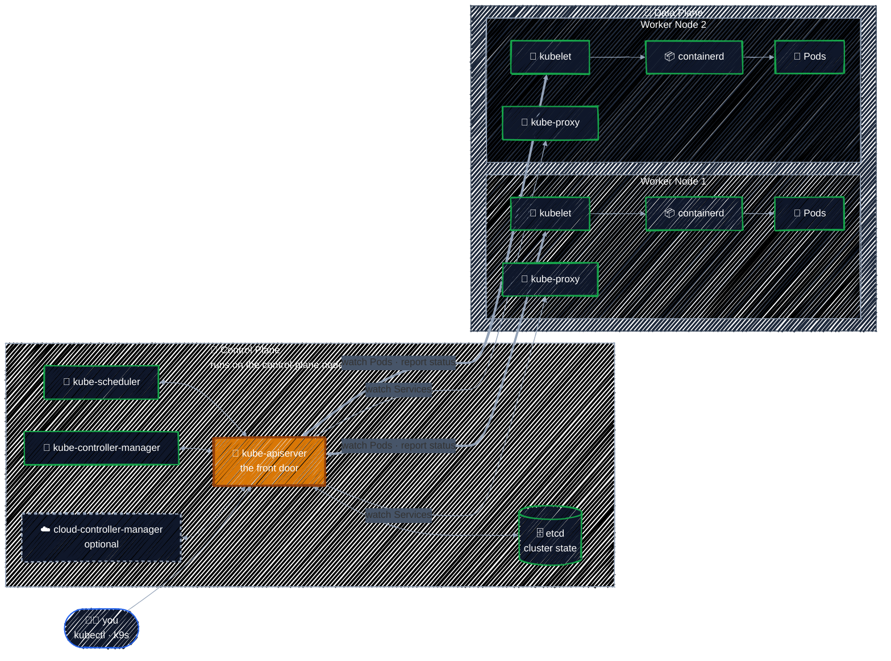

# Architecture Overview

> The component map to carry through the whole tutorial: a control plane that decides, and worker nodes that run.

---

A Kubernetes cluster has two halves:

- **The control plane** — the brain. It stores the desired state and decides what should run where.
- **The data plane** — the muscle. One or more **worker nodes** that actually pull images and run your containers.

Here's a typical multi-node cluster:



Three things to notice:

- **Everything goes through `kube-apiserver`.** You, the scheduler, the controllers, every kubelet — none of them talk to each other directly. The apiserver is the only component that reads and writes `etcd`.
- **Components pull; the apiserver doesn't push.** Each component opens a **watch** on the apiserver and gets notified when something it cares about changes, then writes its results back. That watch is the "observe" step of the [control loop](what-is-kubernetes.md#the-control-loop). Arrows show which way data flows: most components both read and write, while `kube-proxy` only reads. (The one exception: for `kubectl logs`, `exec`, and `port-forward`, the apiserver connects to the kubelet.)
- **Only Pods run on worker nodes.** Objects like Deployments, Services, and Ingresses are records stored in `etcd`; the containers they describe are what land on nodes.

> 📝 **In this lab, it's all one machine.** We build a **single-node** cluster: the control plane and your Pods share one node. The components are exactly the same — they just don't have separate machines to spread across.

### Two names worth knowing

- **"Master node"** is the old name for a control-plane node. You'll still see it in older docs and blog posts; Kubernetes now says **control plane**.
- **`cloud-controller-manager`** is optional. On a cloud provider (AWS, GCP, Azure), it creates real cloud resources for you — load balancers, disks, routes. Our kubeadm lab has no cloud, so it isn't there. That's why a `type: LoadBalancer` Service [stays `<pending>`](../services/what-are-services.md) here unless you add a provider.

### What happens on `kubectl apply`

Tracing one command ties it all together:

```
1. kubectl ───▶ kube-apiserver      "create this Deployment" (validated, written to etcd)
2. controller-manager               creates the ReplicaSet, then the Pod objects
3. kube-scheduler                   sees the unassigned Pods, assigns each to a node
4. kubelet (on that node)           sees its assigned Pods, tells containerd to run them
5. containerd                       pulls the image, starts the containers
6. kubelet                          reports "Running" back to the apiserver → you see it in kubectl/k9s
```

Notice the pattern: **you never command components directly.** Each step is the [control loop](what-is-kubernetes.md#the-control-loop) from the previous chapter, running inside a real component — each one watches the apiserver and converges toward the desired state.

The same split shows up in every object: you write `spec` (what you want), while controllers and kubelets report `status` (what is true now).

### Go deeper

Each half gets its own chapter:

- **[The Control Plane](control-plane.md)** — `kube-apiserver`, `etcd`, `kube-scheduler`, `kube-controller-manager`.
- **[The Data Plane](data-plane.md)** — `kubelet`, `containerd`, `kube-proxy`, plus add-ons (CNI, CoreDNS).

---

[← What is Kubernetes?](what-is-kubernetes.md) · [↑ Contents](../../README.md) · [The Control Plane →](control-plane.md)
