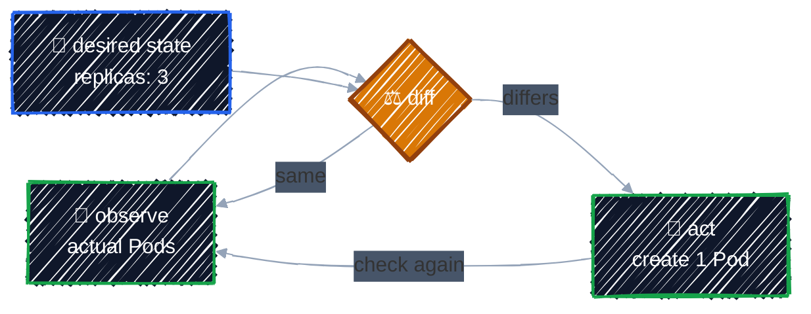

# What is Kubernetes?

> Declare the state you want; let the cluster make reality match — and keep it that way.

---

Kubernetes (often shortened to **k8s** — "k", eight letters, "s") is an open-source system for running containers across a pool of machines. The name is Greek for *helmsman*: you set the course, it steers. It grew out of Google's internal container systems and is now maintained by the Cloud Native Computing Foundation (CNCF).

### Imperative vs. declarative

The mental shift from `docker run` is **imperative vs. declarative**. Here's the same goal — three copies of a web server — both ways:

```bash
# Imperative — you do every step
docker run -d --name web1 nginx:1.27
docker run -d --name web2 nginx:1.27
docker run -d --name web3 nginx:1.27
# The server dies? You notice, and start all three somewhere else.
```

```yaml
# Declarative — you state the goal (excerpt of a Deployment)
spec:
  replicas: 3
  template:
    spec:
      containers:
        - name: web
          image: nginx:1.27
# A Pod dies? The cluster notices, and replaces it.
```

```bash
kubectl apply -f web.yaml   # one file, one command
```

- **Imperative**: each command changes the system one step at a time. You own every step — including noticing when something breaks.
- **Declarative**: you describe the end state in a file and hand it over with `kubectl apply`. You own the goal; the cluster owns the steps.

A nice side effect: applying the same file twice changes nothing the second time. That makes the file safe to re-apply and natural to keep in Git. You'll write the full version in the [Deployment](../core-objects/deployment.md) chapter.

### The control loop

How does the cluster "own the steps"? With **controllers** — small programs that each run the same loop, forever:



**Observe** what's actually running, **diff** it against what you declared, **act** to close the gap — then check again. Most of the time the two match, and the loop simply keeps watching. This is called **reconciliation**, and every object in this guide is driven by a loop like this.

### One idea, three payoffs

Most of what makes Kubernetes useful falls out of that one loop:

- **Resilience** — a Pod crashes or a node dies, actual drops to 2, and the loop creates a replacement without anyone stepping in.
- **Scalability** — change `replicas: 3` to `replicas: 10`, and the same loop sees the gap and creates seven more.
- **Automation** — nobody runs the steps. You change the goal; controllers do the work.

### Built to be extended

The loop isn't limited to built-in objects: Kubernetes can be extended with your own object types and controllers, running the very same loop. That's why its ecosystem has grown to thousands of tools — they all plug into the same API.

### Who runs the loops?

Controllers live in the **control plane** — the brain of the cluster. Your apps run on **worker nodes** — the muscle. How those two halves fit together is the [next chapter](architecture.md).

---

[← Why Use Kubernetes?](why-kubernetes.md) · [↑ Contents](../../README.md) · [Architecture Overview →](architecture.md)
