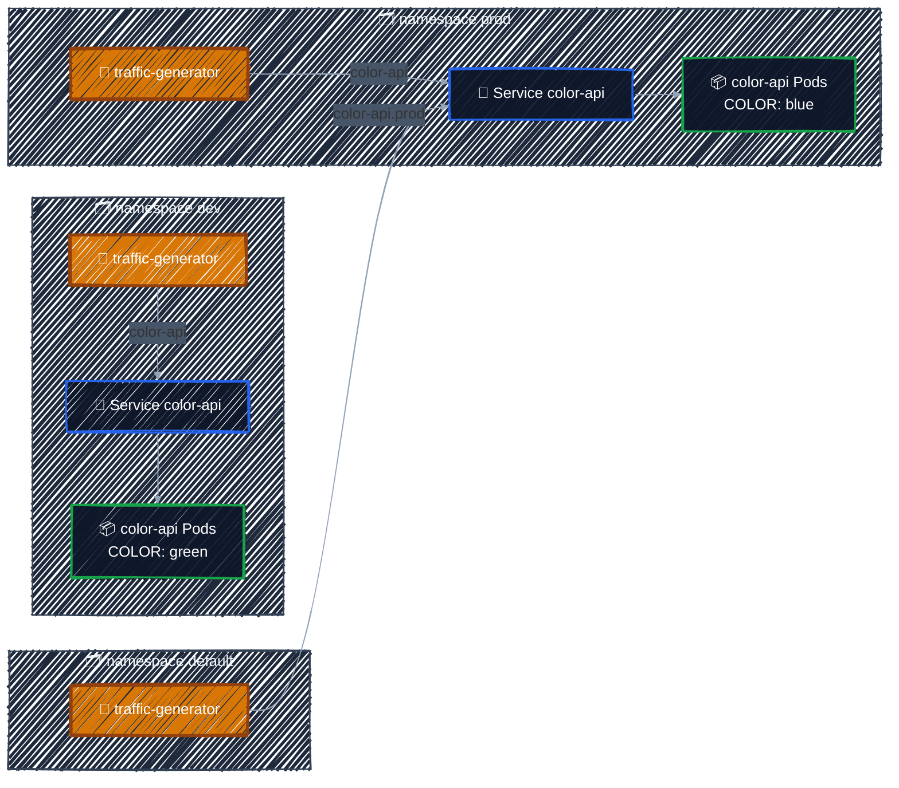

# Cross-Namespace Service Communication

> Run color-api in `dev` and `prod`, see the short Service name stay inside its own namespace, and reach across with `name.namespace`.

---

[ClusterIP Services](../services/clusterip-services.md#5-how-the-name-works) listed three ways to write a Service's name: the short name, `name.namespace`, and the full name. Back then everything lived in `default`, so the short name was all you needed. Now you have namespaces, and the question becomes real: when the traffic generator and color-api sit in **different** namespaces, which name gets through?

You'll build this, with color-api answering `green` in dev and `blue` in prod, so every line of the traffic generator's output tells you which environment answered:



## Before you start

You need the color-api and traffic-generator images from [Traffic Generator](../services/traffic-generator.md), and no `dev` or `prod` namespace left over from [Creating and Managing Namespaces](managing-namespaces.md#clean-up). If a `traffic-generator` Pod from the Services part is still in `default`, delete it:

```bash
kubectl delete pod traffic-generator --ignore-not-found
```

This chapter has two manifests, both with your Docker Hub username to fill in:

- [`color-api.yaml`](../../manifests/labels-namespaces/color-api.yaml): a color-api Deployment with two replicas, and a ClusterIP Service simply called `color-api`. The color comes from a `<COLOR>` placeholder, so each environment can have its own.
- [`traffic-generator.yaml`](../../manifests/labels-namespaces/traffic-generator.yaml): the traffic generator, calling `http://color-api/api?format=text`, the short name, once a second.

Make a copy of color-api for each environment, and one of the traffic generator. As always, work on the copies in `/tmp`, not on the files in `manifests/`:

```bash
DOCKERHUB_USER=your-dockerhub-user      # ← change this to your username
mkdir -p /tmp/xns
sed "s/<YOUR_DOCKERHUB_USER>/$DOCKERHUB_USER/; s/<COLOR>/green/" \
  manifests/labels-namespaces/color-api.yaml > /tmp/xns/color-api-dev.yaml
sed "s/<YOUR_DOCKERHUB_USER>/$DOCKERHUB_USER/; s/<COLOR>/blue/" \
  manifests/labels-namespaces/color-api.yaml > /tmp/xns/color-api-prod.yaml
sed "s/<YOUR_DOCKERHUB_USER>/$DOCKERHUB_USER/" \
  manifests/labels-namespaces/traffic-generator.yaml > /tmp/xns/traffic-generator.yaml
grep -h 'image:\|value:' /tmp/xns/*.yaml   # check: your username, and green / blue
```

## 1. The same Service in two namespaces

Create `dev` and `prod` again, and put color-api in both:

```bash
kubectl apply -f manifests/labels-namespaces/environments.yaml
kubectl apply -f /tmp/xns/color-api-dev.yaml -n dev
kubectl apply -f /tmp/xns/color-api-prod.yaml -n prod
kubectl get deployments,services -A -l app=color-api
```

```text
NAMESPACE   NAME                        READY   UP-TO-DATE   AVAILABLE   AGE
dev         deployment.apps/color-api   2/2     2            2           10s
prod        deployment.apps/color-api   2/2     2            2           10s

NAMESPACE   NAME                TYPE        CLUSTER-IP      EXTERNAL-IP   PORT(S)   AGE
dev         service/color-api   ClusterIP   10.105.56.166   <none>        80/TCP    10s
prod        service/color-api   ClusterIP   10.97.170.173   <none>        80/TCP    10s
```

Two Services, both named `color-api`, each with its own ClusterIP, each sending traffic to the Pods in its own namespace. The only difference between them is the namespace, so the namespace is what has to end up in the name a client uses.

## 2. The short name stays at home

Start the same traffic generator in both namespaces. Its URL says only `color-api`:

```bash
kubectl apply -f /tmp/xns/traffic-generator.yaml -n dev
kubectl apply -f /tmp/xns/traffic-generator.yaml -n prod
kubectl wait --for=condition=Ready pod/traffic-generator -n dev --timeout=90s
kubectl wait --for=condition=Ready pod/traffic-generator -n prod --timeout=90s
```

Give them a few seconds to send some requests, then read both:

```bash
kubectl logs traffic-generator -n dev --tail=3
kubectl logs traffic-generator -n prod --tail=3
```

```text
[2026-11-26 07:49:29] COLOR: green, HOSTNAME: color-api-654d697c4b-nvvm7
[2026-11-26 07:49:30] COLOR: green, HOSTNAME: color-api-654d697c4b-nvvm7
[2026-11-26 07:49:31] COLOR: green, HOSTNAME: color-api-654d697c4b-2hqdg
[2026-11-26 07:49:29] COLOR: blue, HOSTNAME: color-api-65df75d46c-rtmz7
[2026-11-26 07:49:30] COLOR: blue, HOSTNAME: color-api-65df75d46c-rtmz7
[2026-11-26 07:49:31] COLOR: blue, HOSTNAME: color-api-65df75d46c-krpmh
```

The same file, with the same URL, reached dev's color-api from dev, and prod's from prod. Never the other one. The reason is the first line of each Pod's `/etc/resolv.conf`:

```bash
kubectl exec traffic-generator -n dev -- cat /etc/resolv.conf
```

```text
search dev.svc.cluster.local svc.cluster.local cluster.local
nameserver 10.96.0.10
options ndots:5
```

In `default`, that line started with `default.svc.cluster.local`. Here it starts with `dev.svc.cluster.local`: each Pod's search list begins with **its own namespace**. So the short name `color-api` is tried as `color-api.dev.svc.cluster.local` in dev, and as `color-api.prod.svc.cluster.local` in prod.

That's a feature, not a limitation. An app's configuration can say `color-api`, and the same manifest works in every environment, talking to that environment's own backend.

## 3. Reach into another namespace

Now run the traffic generator somewhere that has no color-api: `default`.

```bash
kubectl apply -f /tmp/xns/traffic-generator.yaml
kubectl wait --for=condition=Ready pod/traffic-generator --timeout=90s
```

A few seconds later:

```bash
kubectl logs traffic-generator --tail=3
```

```text
[2026-11-26 07:49:42] (no response from http://color-api/api?format=text)
[2026-11-26 07:49:43] (no response from http://color-api/api?format=text)
[2026-11-26 07:49:44] (no response from http://color-api/api?format=text)
```

The traffic generator only says "no response". Run the same request by hand, and curl tells you why:

```bash
kubectl exec traffic-generator -- curl -sS -m 2 'http://color-api/api?format=text'
```

```text
curl: (6) Could not resolve host: color-api
command terminated with exit code 6
```

Not a timeout or a refused connection: the name doesn't exist. In `default`, `color-api` becomes `color-api.default.svc.cluster.local`, and there's no Service by that name. The Services in dev and prod are never tried.

To reach one, add its namespace to the name. Point a copy of the traffic generator at `color-api.prod`:

```bash
sed 's#http://color-api/#http://color-api.prod/#' /tmp/xns/traffic-generator.yaml \
  > /tmp/xns/traffic-generator-to-prod.yaml
kubectl delete pod traffic-generator
kubectl apply -f /tmp/xns/traffic-generator-to-prod.yaml
kubectl wait --for=condition=Ready pod/traffic-generator --timeout=90s
```

A few seconds later:

```bash
kubectl logs traffic-generator --tail=3
```

```text
[2026-11-26 07:49:53] COLOR: blue, HOSTNAME: color-api-65df75d46c-rtmz7
[2026-11-26 07:49:54] COLOR: blue, HOSTNAME: color-api-65df75d46c-rtmz7
[2026-11-26 07:49:55] COLOR: blue, HOSTNAME: color-api-65df75d46c-krpmh
```

Blue: prod answers. The search list did the rest: `color-api.prod` was tried as `color-api.prod.default.svc.cluster.local`, which doesn't exist, then as `color-api.prod.svc.cluster.local`, which does. The namespace in the name picks the environment, so `color-api.dev` gets green:

```bash
kubectl exec traffic-generator -- curl -s -m 2 'http://color-api.dev/api?format=text'
```

```text
COLOR: green, HOSTNAME: color-api-654d697c4b-2hqdg
```

## 4. Which name to write

All of these work from any Pod in the cluster:

```bash
kubectl exec traffic-generator -- curl -s -m 2 'http://color-api.prod.svc/api?format=text'
kubectl exec traffic-generator -- curl -s -m 2 'http://color-api.prod.svc.cluster.local/api?format=text'
```

```text
COLOR: blue, HOSTNAME: color-api-65df75d46c-rtmz7
COLOR: blue, HOSTNAME: color-api-65df75d46c-krpmh
```

You'll often read that crossing namespaces "requires the fully qualified domain name". You've just seen that `color-api.prod` is enough, because the search list fills in the rest. Here's how to choose:

| Write | When |
|---|---|
| `color-api` | The client and the Service are in the **same** namespace, and should stay together. The same config then works in every environment |
| `color-api.prod` | The Service is in **another** namespace. Short, readable, and works in any cluster |
| `color-api.prod.svc.cluster.local` | The name is resolved somewhere the search list doesn't apply, like the ExternalName below. Note the `cluster.local` part: it's a setting, and a cluster can use another domain |

For most apps, the first two cover everything: the short name for a backend in your own namespace, and `name.namespace` for a shared one somewhere else.

### Give a Service in another namespace a local name

There's a third option, which combines the two: keep the short name in the client, and decide in **its** namespace where that name leads. An [ExternalName Service](../services/externalname-services.md) does it. In Part 6 it pointed at a name outside the cluster, but it can point at another Service's name just as well. [`manifests/labels-namespaces/color-api-alias.yaml`](../../manifests/labels-namespaces/color-api-alias.yaml):

```yaml
apiVersion: v1
kind: Service
metadata:
  name: color-api                 # the short name clients in this namespace use
spec:
  type: ExternalName
  externalName: color-api.prod.svc.cluster.local   # must be the full name
```

Create it in `default`, and call the short name again:

```bash
kubectl apply -f manifests/labels-namespaces/color-api-alias.yaml
kubectl exec traffic-generator -- curl -sS -m 2 'http://color-api/api?format=text'
```

```text
COLOR: blue, HOSTNAME: color-api-65df75d46c-rtmz7
```

If you get `Could not resolve host` instead, wait half a minute and try again. The traffic generator asked for `color-api` in step 3, and CoreDNS remembers a "not found" answer for up to 30 seconds.

Now `color-api` in `default` means prod's color-api. Clients keep their simple config, and switching them to dev is a one-line change to the alias, not to every client.

The comment in the file matters. CoreDNS answers a lookup of the alias with the `externalName`, exactly as written, and then resolves that as a complete name: no search list is involved at that point. So `externalName: color-api.prod` leads to a name that doesn't exist, and `Could not resolve host`. Here, only the full name works.

## 5. Nothing stops dev from calling prod

The namespace in a name decides where a request goes. Nothing checks whether it **should** go there. From the dev traffic generator:

```bash
kubectl exec traffic-generator -n dev -- curl -s -m 2 'http://color-api.prod/api?format=text'
```

```text
COLOR: blue, HOSTNAME: color-api-65df75d46c-rtmz7
```

Dev just called prod. With a real app, that's dev writing to prod's database because someone typed `.prod` into a config file. As [Namespaces](namespaces.md#3-what-a-namespace-does-and-doesnt-separate) said, a namespace isn't a firewall. To allow traffic into prod only from prod, add a [NetworkPolicy](../running-and-operating/security-basics.md#networkpolicy-namespaces-are-not-firewalls). It can pick the allowed namespaces by the `kubernetes.io/metadata.name` label you saw in [Creating and Managing Namespaces](managing-namespaces.md#1-create-dev-and-prod).

## Clean up

```bash
kubectl delete pod traffic-generator
kubectl delete -f manifests/labels-namespaces/color-api-alias.yaml
kubectl delete -f manifests/labels-namespaces/environments.yaml
rm -rf /tmp/xns
```

Deleting the two namespaces removes everything in them: both color-apis, their Services, and both traffic generators. The traffic generator and the alias in `default` are the only things you delete by hand.

## Best practices

- **Use the short name for Services in your own namespace.** The same manifest then works in every environment, and talks to that environment's backend.
- **Use `name.namespace` to cross namespaces**, and make the crossing visible in the config: `color-api.prod` says exactly where it goes.
- **Reach for the full name only when you need it**, and remember that `cluster.local` is a setting, not a constant.
- **Point an ExternalName alias at the full name.** `color-api.prod.svc.cluster.local` works; `color-api.prod` doesn't, because no search list applies there.
- **When a cross-namespace call fails, check the name before the network.** `Could not resolve host` means the name, usually a missing or wrong namespace.
- **Don't rely on names to keep environments apart.** One wrong namespace in a config file crosses the line; a NetworkPolicy is what stops it.

---

[← Creating and Managing Namespaces](managing-namespaces.md) · [↑ Contents](../../README.md) · [Requests and Limits →](../resources-probes/requests-limits.md)
