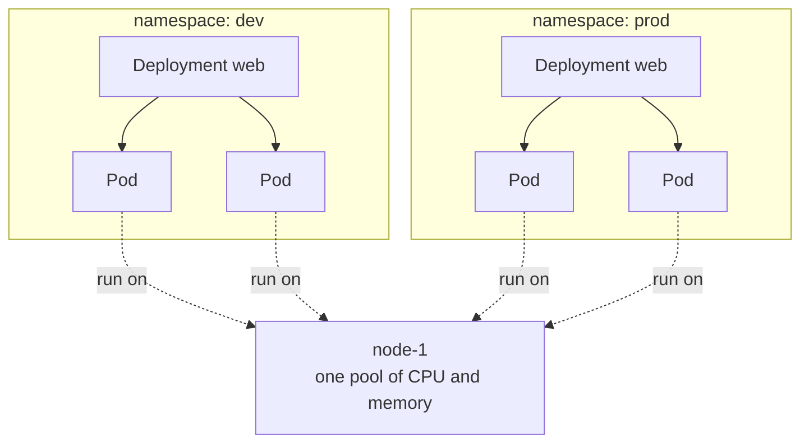

# Namespaces

> What a namespace is, the ones your cluster came with, what it does and doesn't keep apart, and when to use one.

---

Picture a company with one cluster and two environments. Development and production both run an `ecommerce-backend` Deployment, a `payment-db` StatefulSet, and their Services. In one flat cluster, that can't work: two Deployments can't share a name, so every object would need an `-dev` or `-prod` suffix. Every `kubectl get pods` would list both environments mixed together. And one wrong `kubectl delete` meant for dev could take out prod.

A **namespace** solves the first two problems, and helps with the third. It's a named group inside the cluster. An object's name only has to be unique **within** its namespace, so dev and prod can each have an `ecommerce-backend`. Commands work on one namespace at a time, so you see and change one environment, not both. Namespaces are also where you attach rules: a quota on how much CPU and memory a group can use, and permissions for who can touch what.



Note the bottom of that picture. A namespace groups **objects**. It doesn't give each group its own machines: Pods from every namespace run on the same nodes and share their CPU and memory. Step 3 comes back to what that means.

This chapter is the overview: the namespaces you already have, which objects live in one, and what a namespace does and doesn't do for you. In the [next chapter](managing-namespaces.md), you'll create `dev` and `prod` and work with them.

## Before you start

You only need a running cluster. This chapter only looks; it doesn't create anything.

## 1. The namespaces you already have

Every object you've created so far went into a namespace, whether you said so or not:

```bash
kubectl get namespaces
```

```text
NAME              STATUS   AGE
default           Active   5d
kube-flannel      Active   5d
kube-node-lease   Active   5d
kube-public       Active   5d
kube-system       Active   5d
```

Four of these come with every cluster:

| Namespace | What's in it |
|---|---|
| `default` | Everything you create without naming a namespace. That's every Pod, Deployment, and Service in this tutorial so far |
| `kube-system` | The cluster's own components: the API server, etcd, the scheduler, CoreDNS, kube-proxy. Leave it to Kubernetes |
| `kube-public` | Objects meant to be public. On a kubeadm cluster that's mainly the `cluster-info` ConfigMap, which anyone can read, even without logging in, so `kubeadm join` can find the cluster |
| `kube-node-lease` | One Lease per node. The kubelet renews its node's Lease every few seconds, and that's how the control plane knows the node is alive |

`kube-flannel` isn't one of them. The flannel network plugin made it for its own Pods, when [your cluster was set up](../cluster-setup/before-you-start.md). Add-ons often work this way: one namespace per add-on.

`kubectl` shows you `default` unless you ask for another namespace. Ask for `kube-system` with `-n`, short for `--namespace`:

```bash
kubectl get pods -n kube-system
```

```text
NAME                              READY   STATUS    RESTARTS   AGE
coredns-55cb58b774-2dbzz          1/1     Running   0          5d
coredns-55cb58b774-xkwcg          1/1     Running   0          5d
etcd-node-1                       1/1     Running   0          5d
kube-apiserver-node-1             1/1     Running   0          5d
kube-controller-manager-node-1    1/1     Running   0          5d
kube-proxy-sfx5m                  1/1     Running   0          5d
kube-scheduler-node-1             1/1     Running   0          5d
```

These are the control plane Pods from [The Control Plane](../getting-started/control-plane.md). They were running the whole time; a plain `kubectl get pods` just never looked in their namespace. To look in every namespace at once, use `-A`, short for `--all-namespaces`:

```bash
kubectl get pods -A
```

```text
NAMESPACE      NAME                              READY   STATUS    RESTARTS   AGE
kube-flannel   kube-flannel-ds-4t4jr             1/1     Running   0          5d
kube-system    coredns-55cb58b774-2dbzz          1/1     Running   0          5d
kube-system    coredns-55cb58b774-xkwcg          1/1     Running   0          5d
kube-system    etcd-node-1                       1/1     Running   0          5d
kube-system    kube-apiserver-node-1             1/1     Running   0          5d
kube-system    kube-controller-manager-node-1    1/1     Running   0          5d
kube-system    kube-proxy-sfx5m                  1/1     Running   0          5d
kube-system    kube-scheduler-node-1             1/1     Running   0          5d
```

A `NAMESPACE` column appears, and the flannel Pod shows up next to the control plane. Nothing from `default`: you have no Pods running there right now.

## 2. Which objects live in a namespace

Pods, Deployments, ReplicaSets, Services, ConfigMaps, and Secrets all belong to a namespace. For them, a name only has to be unique within the namespace, so an object's full identity is its kind, its namespace, and its name: Deployment `dev/web` and Deployment `prod/web` are two different objects.

Some objects belong to the whole cluster instead: the namespaces themselves, the nodes, and PersistentVolumes, among others. `kubectl api-resources` tells you which is which:

```bash
kubectl api-resources --namespaced=false
```

```text
NAME                                SHORTNAMES   APIVERSION                        NAMESPACED   KIND
componentstatuses                   cs           v1                                false        ComponentStatus
namespaces                          ns           v1                                false        Namespace
nodes                               no           v1                                false        Node
persistentvolumes                   pv           v1                                false        PersistentVolume
...
```

For these, `-n` means nothing, and `kubectl` ignores it without complaint:

```bash
kubectl get nodes -n kube-system
```

```text
NAME     STATUS   ROLES           AGE   VERSION
node-1   Ready    control-plane   5d    v1.30.x
```

That's not "the nodes in kube-system". There's no such thing: the node belongs to the cluster, and runs Pods from every namespace.

Namespaces don't nest, either. There's no `prod/payments`; if you want that, it's a namespace called `prod-payments`.

## 3. What a namespace does and doesn't separate

Here's the catch with the picture from the start. Namespaces separate **names** and **views**. Other things don't stop at a namespace unless you add more:

| | Separated by a namespace? | What adds it |
|---|---|---|
| Object names | Yes | |
| What `kubectl get` shows | Yes, unless you use `-A` | |
| CPU and memory | No. All namespaces share the nodes, so busy Pods in dev can starve prod | [Requests and limits](../resources-probes/requests-limits.md) on each Pod, and a [ResourceQuota](../resources-probes/resource-quotas.md) on the namespace's total |
| Who can change what | No. Your admin account can change every namespace | [RBAC](../running-and-operating/security-basics.md#permissions-rbac) rules, scoped to a namespace |
| Network traffic | No. Any Pod can reach any other Pod's IP | [NetworkPolicy](../running-and-operating/security-basics.md#networkpolicy-namespaces-are-not-firewalls) |
| Service names in DNS | Partly. The short name only works inside the namespace | The full name works from anywhere, in [Cross-Namespace Service Communication](cross-namespace-services.md) |

A namespace is a label on a group of objects, not a wall around them. You'll prove the network row in the [next chapter](managing-namespaces.md#4-namespaces-dont-stop-traffic), with a Pod in dev calling a Pod in prod. For a real boundary between teams or environments, you add the rules in the right-hand column on top.

## 4. When to use one

Namespaces earn their place when a cluster is shared, and the sharing needs some order:

| Use | What the namespaces separate |
|---|---|
| **Environments** | `dev`, `staging`, and `prod` each get their own objects, and can get different quotas and policies |
| **Teams** | Each team manages its own apps in its own namespace, without tripping over another team's names |
| **Resource limits** | A ResourceQuota is written for one namespace, and counts everything in it. So a group you want to cap as a whole needs a namespace of its own |
| **Access control** | An RBAC Role lives in one namespace, and grants access to that namespace only. So "this team may change these apps" works best when the apps share a namespace |

The last two are the reason namespaces matter beyond tidiness: quotas and permissions attach to a namespace, so where you draw namespace lines decides what you can cap and protect separately.

What a namespace isn't: a separate cluster. Everything still shares the same control plane, the same nodes, and, unless you add NetworkPolicies, the same network. When teams need stronger separation than that, for example different Kubernetes versions or a hard security boundary, they use separate clusters.

## Best practices

- **Don't overuse them.** A namespace per environment, or per team, is usually enough. If you can't say what a namespace keeps apart, you probably don't need it.
- **Choose the dimension on purpose.** Split by environment (`dev`, `prod`), by team, or by both, like `payments-prod`, to match how your people and projects are organized.
- **In a real cluster, don't build on `default`.** This tutorial uses it because it's simplest, but in a shared cluster, put each app or environment in a namespace you create, so it can get its own quota and permissions. Leave the `kube-` namespaces to Kubernetes.
- **Add the boundaries a namespace doesn't give you**, from the right-hand column of [step 3's table](#3-what-a-namespace-does-and-doesnt-separate).

---

[← Annotations](annotations.md) · [↑ Contents](../../README.md) · [Creating and Managing Namespaces →](managing-namespaces.md)
