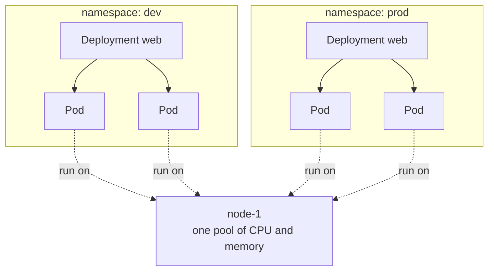

# Namespaces

> Split one cluster into named groups, put the same app in two of them, switch between them, and see what deleting one removes.

---

Picture a company with one cluster and two environments. Development and production both run an `ecommerce-backend` Deployment, a `payment-db` StatefulSet, and their Services. In one flat cluster, that can't work: two Deployments can't share a name, so every object would need an `-dev` or `-prod` suffix. Every `kubectl get pods` would list both environments mixed together. And one wrong `kubectl delete` meant for dev could take out prod.

A **namespace** solves the first two problems, and helps with the third. It's a named group inside the cluster. An object's name only has to be unique **within** its namespace, so dev and prod can each have an `ecommerce-backend`. Commands work on one namespace at a time, so you see and change one environment, not both. Namespaces are also where you attach rules: a quota on how much CPU and memory a group can use, and permissions for who can touch what.



Note the bottom of that picture. A namespace groups **objects**. It doesn't give each group its own machines: Pods from every namespace run on the same nodes and share their CPU and memory. Step 5 comes back to what that means.

In this chapter you'll see the namespaces your cluster came with, create `dev` and `prod`, run the same Deployment in both, change your current namespace, and delete one namespace with everything in it.

## Before you start

You only need a running cluster. Check that `kubectl` is using the `default` namespace:

```bash
kubectl config get-contexts
```

```text
CURRENT   NAME                          CLUSTER      AUTHINFO           NAMESPACE
*         kubernetes-admin@kubernetes   kubernetes   kubernetes-admin
```

An empty `NAMESPACE` column means `default`. If it shows something else, step 4 explains how to change it.

## 1. The namespaces you already have

Every object you've created so far went into a namespace, whether you said so or not:

```bash
kubectl get namespaces
```

```text
NAME              STATUS   AGE
default           Active   5d
kube-flannel      Active   5d
kube-node-lease   Active   5d
kube-public       Active   5d
kube-system       Active   5d
```

Four of these come with every cluster:

| Namespace | What's in it |
|---|---|
| `default` | Everything you create without naming a namespace. That's every Pod, Deployment, and Service in this tutorial so far |
| `kube-system` | The cluster's own components: the API server, etcd, the scheduler, CoreDNS, kube-proxy. Leave it to Kubernetes |
| `kube-public` | Objects meant to be public. On a kubeadm cluster that's mainly the `cluster-info` ConfigMap, which anyone can read, even without logging in, so `kubeadm join` can find the cluster |
| `kube-node-lease` | One Lease per node. The kubelet renews its node's Lease every few seconds, and that's how the control plane knows the node is alive |

`kube-flannel` isn't one of them. The flannel network plugin made it for its own Pods, when [your cluster was set up](../cluster-setup/before-you-start.md). Add-ons often work this way: one namespace per add-on.

`kubectl` shows you `default` unless you ask for another namespace. Ask for `kube-system` with `-n`, short for `--namespace`:

```bash
kubectl get pods -n kube-system
```

```text
NAME                              READY   STATUS    RESTARTS   AGE
coredns-55cb58b774-2dbzz          1/1     Running   0          5d
coredns-55cb58b774-xkwcg          1/1     Running   0          5d
etcd-node-1                       1/1     Running   0          5d
kube-apiserver-node-1             1/1     Running   0          5d
kube-controller-manager-node-1    1/1     Running   0          5d
kube-proxy-sfx5m                  1/1     Running   0          5d
kube-scheduler-node-1             1/1     Running   0          5d
```

These are the control plane Pods from [The Control Plane](../getting-started/control-plane.md). They were running the whole time; a plain `kubectl get pods` just never looked in their namespace.

## 2. Create `dev` and `prod`

A namespace is an object like any other. `kubectl create namespace dev` would make one, but a manifest lets you label it too. [`manifests/labels-namespaces/environments.yaml`](../../manifests/labels-namespaces/environments.yaml) holds two:

```yaml
apiVersion: v1
kind: Namespace
metadata:
  name: dev
  labels:
    env: dev
---
apiVersion: v1
kind: Namespace
metadata:
  name: prod
  labels:
    env: prod
```

```bash
kubectl apply -f manifests/labels-namespaces/environments.yaml
kubectl get namespaces --show-labels
```

```text
NAME              STATUS   AGE   LABELS
default           Active   5d    kubernetes.io/metadata.name=default
dev               Active   3s    env=dev,kubernetes.io/metadata.name=dev
kube-flannel      Active   5d    k8s-app=flannel,kubernetes.io/metadata.name=kube-flannel,...
kube-node-lease   Active   5d    kubernetes.io/metadata.name=kube-node-lease
kube-public       Active   5d    kubernetes.io/metadata.name=kube-public
kube-system       Active   5d    kubernetes.io/metadata.name=kube-system
prod              Active   3s    env=prod,kubernetes.io/metadata.name=prod
```

Namespaces take labels like anything else, so `kubectl get namespaces -l env` lists just your two environments. Kubernetes also adds `kubernetes.io/metadata.name` to every namespace, holding its name. That one's there so a selector can pick a namespace by name, which you'll need for rules that apply across namespaces.

A namespace's name ends up in DNS names, as the [next chapter](cross-namespace-services.md) shows, so the rules are strict: lowercase letters, digits, and `-`, up to 63 characters.

```bash
kubectl create namespace Dev_Team
```

```text
The Namespace "Dev_Team" is invalid: metadata.name: Invalid value: "Dev_Team": a lowercase RFC 1123 label must consist of lower case alphanumeric characters or '-', and must start and end with an alphanumeric character ...
```

Namespaces don't nest, either. There's no `prod/payments`; if you want that, it's a namespace called `prod-payments`.

## 3. The same Deployment in both

[`manifests/labels-namespaces/web.yaml`](../../manifests/labels-namespaces/web.yaml) is a small nginx Deployment called `web`. Its `metadata` has no `namespace`, so it goes wherever you send it. Send it to both:

```bash
kubectl apply -f manifests/labels-namespaces/web.yaml -n dev
kubectl apply -f manifests/labels-namespaces/web.yaml -n prod
```

```text
deployment.apps/web created
deployment.apps/web created
```

Two objects named `web`, both `created`. In one namespace, the second would have been `unchanged`, since it's the same object. Now look:

```bash
kubectl get deployments
```

```text
No resources found in default namespace.
```

Nothing, because you're still in `default`. Each namespace has its own:

```bash
kubectl get deployments -n dev
```

```text
NAME   READY   UP-TO-DATE   AVAILABLE   AGE
web    2/2     2            2           10s
```

To see across all namespaces at once, use `-A`, short for `--all-namespaces`. It adds a `NAMESPACE` column, and works with `-l`:

```bash
kubectl get pods -A -l app=web
```

```text
NAMESPACE   NAME                   READY   STATUS    RESTARTS   AGE
dev         web-7b86f8987b-28gsr   1/1     Running   0          15s
dev         web-7b86f8987b-7gls8   1/1     Running   0          15s
prod        web-7b86f8987b-r5csv   1/1     Running   0          14s
prod        web-7b86f8987b-zh67f   1/1     Running   0          14s
```

Even the ReplicaSets share a name, `web-7b86f8987b`. That hash comes from the Pod template, and the template is the same in both. Within a namespace, though, names stay unique, as before:

```bash
kubectl create deployment web --image=nginx:1.27 -n dev
```

```text
error: failed to create deployment: deployments.apps "web" already exists
```

So an object's full identity is its kind, its namespace, and its name: Deployment `dev/web` and Deployment `prod/web`.

## 4. `-n`, `metadata.namespace`, and your current namespace

There are three ways an object's namespace gets decided, and it's worth knowing which one wins.

### In the manifest

A manifest can name its namespace in `metadata.namespace`. Then it goes there, with or without `-n`. [`manifests/labels-namespaces/web-prod.yaml`](../../manifests/labels-namespaces/web-prod.yaml) is the same Deployment, with one line added:

```yaml
metadata:
  name: web
  namespace: prod               # always goes to prod
```

```bash
kubectl apply -f manifests/labels-namespaces/web-prod.yaml
```

```text
deployment.apps/web unchanged
```

`unchanged`, from `default`: the file sent it to `prod`, where `web` already is. If `-n` and the file disagree, `kubectl` refuses, rather than guess:

```bash
kubectl apply -f manifests/labels-namespaces/web-prod.yaml -n dev
```

```text
error: the namespace from the provided object "prod" does not match the namespace "dev". You must pass '--namespace=prod' to perform this operation.
```

### Your current namespace

Without `-n` or `metadata.namespace`, the object goes to your **current namespace**. That's a setting in your kubeconfig, stored with the context. It's been empty all along, which means `default`. Change it to `dev`:

```bash
kubectl config set-context --current --namespace=dev
kubectl config get-contexts
```

```text
CURRENT   NAME                          CLUSTER      AUTHINFO           NAMESPACE
*         kubernetes-admin@kubernetes   kubernetes   kubernetes-admin   dev
```

Now every command without `-n` works in `dev`:

```bash
kubectl get deployments
```

```text
NAME   READY   UP-TO-DATE   AVAILABLE   AGE
web    2/2     2            2           1m
```

`-n` still overrides it for a single command, so `kubectl get deployments -n prod` shows prod's `web`.

This setting is convenient, and also the classic way to lose track of your objects. It lives in `~/.kube/config`, so it stays after you close the terminal. If, days later, `kubectl get pods` says `No resources found` for Pods you know are there, read the namespace in that message, or check `kubectl config get-contexts`. Switch back now:

```bash
kubectl config set-context --current --namespace=default
```

To sum up, from strongest to weakest:

| Where the namespace comes from | Example | Used when |
|---|---|---|
| `metadata.namespace` in the file | `namespace: prod` | Always. If `-n` says something else, `kubectl` stops with an error |
| `-n` on the command | `-n dev` | The file doesn't name one |
| Your current namespace | `kubectl config set-context --current --namespace=dev` | Neither of the above |
| Nothing set | | `default` |

Which should a manifest use? If the same file deploys to several environments, like `web.yaml` here, leave `metadata.namespace` out and pass `-n`. If an object only ever belongs in one place, such as an add-on that lives in its own namespace, write the namespace into the file, so nobody applies it to the wrong one.

### Objects without a namespace

Not everything has a namespace. Namespaces themselves, nodes, and PersistentVolumes belong to the whole cluster, and `kubectl api-resources --namespaced=false` lists the rest. For these, `kubectl` ignores `-n` without complaint:

```bash
kubectl get nodes -n dev
```

```text
NAME     STATUS   ROLES           AGE   VERSION
node-1   Ready    control-plane   5d    v1.30.x
```

That's not "the nodes in dev". There's no such thing: the node belongs to the cluster, and runs Pods from every namespace.

## 5. What a namespace doesn't separate

Here's the catch with the picture from the start. Namespaces separate **names** and **views**. Other things don't stop at a namespace unless you add more:

| | Separated by a namespace? | What adds it |
|---|---|---|
| Object names | Yes | |
| What `kubectl get` shows | Yes, unless you use `-A` | |
| CPU and memory | No. All namespaces share the nodes, so busy Pods in dev can starve prod | [Requests and limits](../resources-probes/requests-limits.md) on each Pod, and a [ResourceQuota](../resources-probes/resource-quotas.md) on the namespace's total |
| Who can change what | No. Your admin account can change every namespace | [RBAC](../running-and-operating/security-basics.md#permissions-rbac) rules, scoped to a namespace |
| Network traffic | No. Any Pod can reach any other Pod's IP | [NetworkPolicy](../running-and-operating/security-basics.md#networkpolicy-namespaces-are-not-firewalls) |
| Service names in DNS | Partly. The short name only works inside the namespace | The full name works from anywhere, in the [next chapter](cross-namespace-services.md) |

The network row is easy to prove. Take the IP of one of prod's Pods, and call it from a temporary Pod in dev:

```bash
PROD_IP=$(kubectl get pod -n prod -l app=web -o jsonpath='{.items[0].status.podIP}')
kubectl run net-test -n dev --rm -i --restart=Never --image=busybox:1.36 \
  -- wget -qO- -T 3 "$PROD_IP" | grep '<title>'
```

```text
<title>Welcome to nginx!</title>
```

Dev just talked to prod, with nothing in between. A namespace is a label on a group of objects, not a wall around them. For a real boundary between teams or environments, you'll add quotas, RBAC, and NetworkPolicies on top.

## 6. Deleting a namespace deletes everything in it

Deleting a namespace deletes every object inside it. Look at what dev holds:

```bash
kubectl get all -n dev
```

```text
NAME                       READY   STATUS    RESTARTS   AGE
pod/web-7b86f8987b-28gsr   1/1     Running   0          3m
pod/web-7b86f8987b-7gls8   1/1     Running   0          3m

NAME                  READY   UP-TO-DATE   AVAILABLE   AGE
deployment.apps/web   2/2     2            2           3m

NAME                             DESIRED   CURRENT   READY   AGE
replicaset.apps/web-7b86f8987b   2         2         2       3m
```

Delete it. `--wait=false` returns right away, so you can watch what happens:

```bash
kubectl delete namespace dev --wait=false
kubectl get namespace dev
```

```text
namespace "dev" deleted
NAME   STATUS        AGE
dev    Terminating   3m
```

`Terminating` means Kubernetes is deleting everything inside first: the Deployment, its ReplicaSet, the Pods, and anything else in there. The namespace goes last.

"Everything inside" means namespaced objects. A PersistentVolumeClaim is deleted with its namespace, but the PersistentVolume behind it belongs to the cluster, and whether it and its data survive depends on its [reclaim policy](../config-and-data/volumes.md#reclaim-policy): `Delete` destroys the data, `Retain` keeps it. Check that before you delete a namespace that holds a database. A few seconds later:

```bash
kubectl get namespace dev
```

```text
Error from server (NotFound): namespaces "dev" not found
```

Prod didn't notice:

```bash
kubectl get deployments -A -l app=web
```

```text
NAMESPACE   NAME   READY   UP-TO-DATE   AVAILABLE   AGE
prod        web    2/2     2            2           3m
```

This is both the danger and the use of a namespace. One command removes a whole environment, with no confirmation and no undo, which is a good reason to keep RBAC in mind. But it's also the cleanest way to tear down a test setup: put it in its own namespace, and delete just that when you're done. Kubernetes protects a few of its own: `kubectl delete namespace default` is refused with `this namespace may not be deleted`, and so are `kube-system` and `kube-public`. `kube-node-lease` isn't on that list, so don't count on the API server to stop you there.

## Clean up

```bash
kubectl delete -f manifests/labels-namespaces/environments.yaml --ignore-not-found
kubectl config get-contexts
```

Deleting `prod` removes its `web` Deployment too. Check that the `NAMESPACE` column is empty or says `default`, so the next chapter starts where it expects.

## Best practices

- **Don't overuse them.** A namespace per environment, or per team, is usually enough. If you can't say what a namespace keeps apart, you probably don't need it.
- **Choose the dimension on purpose.** Split by environment (`dev`, `prod`), by team, or by both, like `payments-prod`, to match how your people and projects are organized.
- **In a real cluster, don't build on `default`.** This tutorial uses it because it's simplest, but in a shared cluster, put each app or environment in a namespace you create, so it can get its own quota and permissions. Leave the `kube-` namespaces to Kubernetes.
- **Know your current namespace.** When objects seem to be missing, check `kubectl config get-contexts`, and prefer `-n` in scripts over relying on the current namespace.
- **Add the boundaries a namespace doesn't give you.** Requests and limits on each Pod and a ResourceQuota on the namespace for CPU and memory, RBAC for who can change what, and NetworkPolicies for traffic.
- **Use a namespace for anything temporary.** One `kubectl delete namespace` removes everything in it, and leaves the rest of the cluster alone.

---

[← Annotations](annotations.md) · [↑ Contents](../../README.md) · [Cross-Namespace Service Communication →](cross-namespace-services.md)
