# From Dockerfile to Pod

> Build your own container image, push it to Docker Hub, and run it as a Pod on your cluster.

---

Every Pod so far ran someone else's image: `nginx`, `busybox`. This chapter runs **yours**. You'll take a small web app, package it with a Dockerfile, publish the image to Docker Hub, and have your cluster pull it and run it.

The work happens in two places:

```mermaid
---
config:
  look: handDrawn
  theme: default
  themeVariables:
    fontFamily: '"Comic Sans MS", "Comic Sans", "Segoe Print", "Bradley Hand", cursive'
    lineColor: '#94A3B8'
    edgeLabelBackground: '#475569'
  themeCSS: |
    .edgeLabel, .edgeLabel p, .edgeLabel span { color: #FFFFFF !important; }
---
flowchart LR
    subgraph laptop["💻 your laptop · Docker Desktop"]
        direction TB
        src["📄 Dockerfile + source"]
        img["🐳 image<br/>you/color-api:1.0.0"]
        src -->|"docker build"| img
    end
    hub[("☁️ Docker Hub")]
    subgraph node["🖥️ the node · kubectl"]
        direction TB
        kubelet["🤖 kubelet + containerd"]
        pod["📦 Pod color-api"]
        kubelet -->|"starts"| pod
    end

    img -->|"docker push"| hub
    hub -->|"pull"| kubelet

    classDef ctrl fill:#0F172A,stroke:#2563EB,stroke-width:2px,color:#FFFFFF
    classDef eng fill:#D97706,stroke:#92400E,stroke-width:3px,color:#FFFFFF
    classDef tgt fill:#0F172A,stroke:#16A34A,stroke-width:2px,color:#FFFFFF
    class src,img eng
    class hub ctrl
    class kubelet,pod tgt

    style laptop fill:#1E293B,stroke:#334155,color:#F1F5F9,fillStyle:solid
    style node fill:#1E293B,stroke:#334155,color:#F1F5F9,fillStyle:solid
```



You **build and push on your laptop**, where Docker Desktop is. The node never sees your source code or your Dockerfile: it only knows an image name, and pulls that image from Docker Hub, exactly as it pulled `nginx`. The registry is the hand-off point between the two machines.

## Before you start

On your **laptop**:

- **Docker Desktop**, running. Check with `docker version`: you should see both a Client and a Server section. (On Windows with WSL, turn on *Settings → Resources → WSL integration* for your distro to use `docker` from the WSL shell.)
- **A Docker Hub account.** Sign up at [hub.docker.com](https://hub.docker.com/) if you don't have one, then log in from the terminal:

  ```bash
  docker login            # prompts for your Docker Hub username and password (or an access token)
  ```

- **This repo**, cloned. The app lives in [`apps/color-api/`](../../apps/color-api/).

On the **node**, a working cluster, as in the previous chapters.

Throughout this chapter, replace `<YOUR_DOCKERHUB_USER>` with your Docker Hub username.

## 1. The app

`color-api` is a tiny [Express](https://expressjs.com/) web server. Here's [`src/index.js`](../../apps/color-api/src/index.js), in full:

```js
const os = require('node:os');
const express = require('express');

const app = express();
const port = Number(process.env.PORT) || 8080;
const color = process.env.COLOR || 'blue';

app.get('/', (req, res) => {
  res.send(
    `<h1 style="color:${color};">Hello from color-api!</h1>` +
      `<p>Served by <code>${os.hostname()}</code></p>`
  );
});

app.get('/api', (req, res) => {
  res.json({ color, hostname: os.hostname() });
});

const server = app.listen(port, () => {
  console.log(`color-api listening on port ${port} (color: ${color})`);
});

// As PID 1, Node ignores stop signals it doesn't handle.
// SIGTERM: Kubernetes and `docker stop`. SIGINT: Ctrl+C.
for (const signal of ['SIGTERM', 'SIGINT']) {
  process.on(signal, () => {
    console.log(`${signal} received, shutting down`);
    server.close(() => process.exit(0));
  });
}
```

`/` is a page for the browser; `/api` returns the same facts as JSON, which is easier to read with `curl`. A few details are there for Kubernetes, not for the app itself:

| Detail | Why |
|---|---|
| **Port 8080**, not 80 | The container runs as a non-root user (see the Dockerfile), and ports below 1024 normally need root. |
| **`COLOR` from an environment variable** | You can change the app's behavior without rebuilding the image: `kubectl run --env=COLOR=red`. |
| **`os.hostname()` in the response** | Inside a Pod, the hostname is the **Pod's name**. Once several Pods serve the same app (in [Deployments](../replicasets-deployments/introduction-to-deployments.md) and [Services](../core-objects/service.md)), this tells you which one answered. |
| **The signal handlers** | The app runs as PID 1 in its container, and PID 1 **ignores** any stop signal it has no handler for. Without them, `kubectl delete pod` hangs for the 30-second grace period before the container is force-killed, and Ctrl+C does nothing at all. See [Graceful Shutdown](../running-and-operating/graceful-shutdown.md). |

## 2. The Dockerfile

[`apps/color-api/Dockerfile`](../../apps/color-api/Dockerfile):

```dockerfile
FROM node:22-alpine
WORKDIR /app
COPY package.json package-lock.json ./
RUN npm ci --omit=dev
COPY src ./src
USER node
EXPOSE 8080
CMD ["node", "src/index.js"]
```

| Line | What it does |
|---|---|
| `FROM node:22-alpine` | Start from the official Node.js 22 image, on the small Alpine Linux base. |
| `WORKDIR /app` | Run every following command in `/app`, creating it if needed. |
| `COPY package.json package-lock.json ./` | Copy only the dependency list, **before** the source. |
| `RUN npm ci --omit=dev` | Install exactly the versions in `package-lock.json`, skipping dev-only packages. |
| `COPY src ./src` | Now copy the source code. |
| `USER node` | Switch from root to the unprivileged `node` user that the base image provides. |
| `EXPOSE 8080` | Documents the port the app listens on. It doesn't publish or open anything. |
| `CMD ["node", "src/index.js"]` | Start the app **directly** with `node`, not `npm start`. |

The two bold choices are ones you'll make in every Dockerfile:

- **Dependencies before source.** Docker caches each step as a *layer* and reuses it until its inputs change. Source changes on almost every build, `package.json` rarely does, so copying it first means the slow `npm ci` is skipped on most rebuilds.
- **`node`, not `npm start`.** Whatever `CMD` starts becomes PID 1, the process that receives stop signals. `npm` doesn't reliably pass them on, so your handlers would never run.

[`.dockerignore`](../../apps/color-api/.dockerignore) keeps a local `node_modules` out of the build, so the image only contains what `npm ci` installs.

## 3. Build and test it locally

On your **laptop**, from the repo root:

```bash
docker build -t <YOUR_DOCKERHUB_USER>/color-api:1.0.0 apps/color-api
```

The `-t` gives the image its name, in the form `<user>/<repository>:<tag>`. The `<user>/` prefix is what tells `docker push` which Docker Hub account it belongs to. See what you built:

```bash
docker image ls <YOUR_DOCKERHUB_USER>/color-api    # SIZE: about 250MB, almost all of it the Node.js base image
```

That's the unpacked size on disk. Images travel compressed, so a node pulls about a quarter of that (you'll see the exact figure in the Pod's Events later). Every node that runs the Pod pays that download, which is why a small base image matters.

> **On an Apple Silicon Mac (M1/M2/…)?** Docker builds for `arm64` by default, but your node is almost certainly `amd64`. Build for the node's architecture instead, or the Pod will crash with `exec format error`:
>
> ```bash
> docker build --platform linux/amd64 -t <YOUR_DOCKERHUB_USER>/color-api:1.0.0 apps/color-api
> ```
>
> To check the node's architecture: `kubectl get nodes -o jsonpath='{.items[0].status.nodeInfo.architecture}'`.

Before shipping it anywhere, make sure it runs:

```bash
docker run --rm -p 8080:8080 <YOUR_DOCKERHUB_USER>/color-api:1.0.0
```

```
color-api listening on port 8080 (color: blue)
```

In another terminal (or a browser at `http://localhost:8080`):

```bash
curl http://localhost:8080/api
```

```
{"color":"blue","hostname":"3f2a9c1b7d4e"}
```

The hostname is the container's ID here. Inside a Pod, it'll be the Pod's name. Press Ctrl+C in the first terminal: thanks to the `SIGINT` handler, the container stops immediately.

## 4. Push it to Docker Hub

```bash
docker push <YOUR_DOCKERHUB_USER>/color-api:1.0.0
```

Docker Hub creates the `color-api` repository on the first push. It's **public** unless you've changed your account's default privacy, which is what you want here: the node pulls it without logging in. Open `https://hub.docker.com/r/<YOUR_DOCKERHUB_USER>/color-api` to see it.

> **Why `1.0.0` and not `latest`?** A version tag tells you exactly which build is running, and lets you go back to it. `latest` is just the default tag name: it isn't automatically the newest image, and a node that already has a `latest` image cached may keep using that old copy.

## 5. Run it on the cluster

Now switch to the **node**. Create the Pod exactly as you did in [Creating Pods](creating-pods.md), only with your image:

```bash
kubectl run color-api --image=<YOUR_DOCKERHUB_USER>/color-api:1.0.0 --port=8080
kubectl wait --for=condition=Ready pod/color-api --timeout=90s
```

Check the Events to see your image come from Docker Hub:

```bash
kubectl describe pod color-api
```

```text
Events:
  Type    Reason     Age    From               Message
  Normal  Scheduled  2m14s  default-scheduler  Successfully assigned default/color-api to node-1
  Normal  Pulling    2m14s  kubelet            spec.containers{color-api}: Pulling image "<YOUR_DOCKERHUB_USER>/color-api:1.0.0"
  Normal  Pulled     119s   kubelet            spec.containers{color-api}: Successfully pulled image "<YOUR_DOCKERHUB_USER>/color-api:1.0.0" in 15.617s (15.617s including waiting). Image size: 63382254 bytes.
  Normal  Created    119s   kubelet            spec.containers{color-api}: Created container: color-api
  Normal  Started    118s   kubelet            spec.containers{color-api}: Started container color-api
```

`Pulled` tells you how long the download took and how big it was: about 63MB, the compressed size.

Then talk to it, using the tools from [Working with Pods](working-with-pods.md):

```bash
kubectl logs color-api                       # color-api listening on port 8080 (color: blue)
POD_IP=$(kubectl get pod color-api -o jsonpath='{.status.podIP}')
curl http://$POD_IP:8080/api                 # {"color":"blue","hostname":"color-api"}
```

The hostname is now `color-api`: the Pod's name.

To see the page in your laptop's browser, use `port-forward` plus the SSH tunnel from [Working with Pods](working-with-pods.md#5-port-forward-reach-the-pod-without-its-ip), then open `http://localhost:8080`:

```bash
kubectl port-forward pod/color-api 8080:8080
```

### Same image, different behavior

Because `COLOR` comes from the environment, one image can run in different ways. Start a second Pod from the **same image**:

```bash
kubectl run color-red --image=<YOUR_DOCKERHUB_USER>/color-api:1.0.0 --port=8080 --env=COLOR=red
kubectl wait --for=condition=Ready pod/color-red --timeout=60s
curl http://$(kubectl get pod color-red -o jsonpath='{.status.podIP}'):8080/api
# {"color":"red","hostname":"color-red"}
```

Notice that this Pod skips `Pulling` in its Events: the image is already on the node. Building an image once and configuring it per environment is the idea behind [ConfigMaps](../config-and-data/configmap.md).

## 6. Ship a new version

Change the app on your **laptop**. For example, in `src/index.js`, change the heading to `Hello from color-api v2!`. Then build and push it under a **new tag** (on an Apple Silicon Mac, add `--platform linux/amd64` again):

```bash
docker build -t <YOUR_DOCKERHUB_USER>/color-api:1.1.0 apps/color-api
docker push <YOUR_DOCKERHUB_USER>/color-api:1.1.0
```

Back on the **node**, point the running Pod at the new image. In [Working with Pods](working-with-pods.md#8-changing-a-pod) you saw that a Pod's spec is mostly immutable, but the container **image** is one of the few fields you *can* change:

```bash
kubectl set image pod/color-api color-api=<YOUR_DOCKERHUB_USER>/color-api:1.1.0
kubectl get pod color-api -w        # RESTARTS goes from 0 to 1; Ctrl+C to stop
```

The `color-api=` part names the container to update (`kubectl run` names it after the Pod). The kubelet stops the old container, pulls `1.1.0`, and starts a new container **in the same Pod**: same name, same IP, `RESTARTS` up by one. Fetch the page (not `/api`, which has no heading) to see the change:

```bash
curl http://$POD_IP:8080/          # <h1 style="color:blue;">Hello from color-api v2!</h1>...
```

Updating one bare Pod by hand like this works, but there's a gap while the container restarts, and you'd have to repeat it for every Pod. A [Deployment](../replicasets-deployments/introduction-to-deployments.md) rolls out a new image across many Pods with no downtime. See [Rolling Updates](../running-and-operating/rolling-updates.md).

## 7. When it goes wrong

| What you see | Likely cause | Fix |
|---|---|---|
| `ErrImagePull`, then `ImagePullBackOff` | A typo in the image name or tag, the tag was never pushed, or the repository is private. | `describe` → Events shows the exact image it tried. Compare it with Docker Hub, and check the repository is public. |
| `CrashLoopBackOff`, and `kubectl logs` shows `exec format error` | The image was built for a different CPU architecture than the node (usually an Apple Silicon Mac). | Rebuild with `--platform linux/amd64`, push a new tag, and use that. |
| Events say `toomanyrequests` | Docker Hub limits how often anonymous clients can pull. | Wait: the kubelet keeps retrying on its own. Pulls made with a logged-in account get a higher limit. |
| `CrashLoopBackOff`, and `kubectl logs` shows a Node.js error | The app itself fails at startup. | Read the logs. Reproduce it with `docker run` on your laptop, where the fix-build-test loop is faster. |

## Clean up

```bash
kubectl delete pod color-api color-red
```

The image stays on Docker Hub, so you can run it again any time.

## Best practices

- **Tag every build with a version**, and never reuse a tag for different code. A tag should always mean the same image.
- **Test with `docker run` before you push.** A broken image is much faster to find on your laptop than through Pod Events.
- **Keep images small and safe:** a small base image, a `.dockerignore`, dependencies copied before source, and a non-root `USER`.
- **Handle stop signals, and start the app directly in `CMD`**, so `kubectl delete` doesn't hang.
- **Build for the node's architecture**, especially from an Apple Silicon Mac.

---

[← Working with Pods](working-with-pods.md) · [↑ Contents](../../README.md) · [Object Management →](../object-management/object-management.md)
