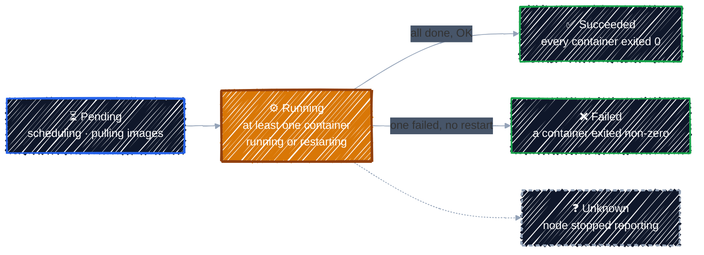
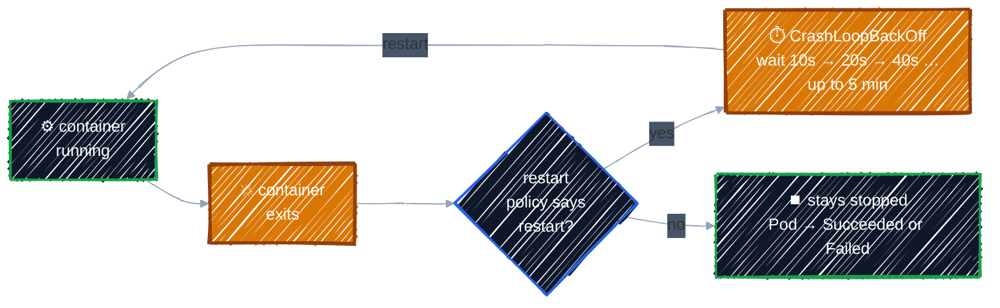

# The Pod Lifecycle

> From Pending to Succeeded or Failed: the phases a Pod moves through, and what restarts its containers.

---

## Before you start

You need the healthy cluster from [Before You Start](../cluster-setup/before-you-start.md), in the `default` namespace. If you have [k9s](../cluster-setup/k9s.md), keep it open on `:pods` in a second terminal while you work through this chapter. Every state change below shows up there live.

## The five phases

Every Pod has a **phase**: a one-word summary of where it is in its life. There are only five:



| Phase | What it means |
|---|---|
| **Pending** | The cluster accepted the Pod, but its containers aren't running yet. It's waiting for the scheduler to pick a node, or for the node to download the images. |
| **Running** | The Pod is on a node, its containers have been created, and at least one is running, starting, or restarting. |
| **Succeeded** | Every container exited with code `0`, and none will be restarted. The work is done. |
| **Failed** | Every container has stopped, and none will be restarted. At least one failed: it exited with a non-zero code, or the system killed it (for example, for using too much memory). |
| **Unknown** | The cluster can't get the Pod's status, usually because the node it runs on stopped reporting in (see [The Data Plane](../getting-started/data-plane.md)). |

Two things surprise most people:

- **Running doesn't mean working.** A container stuck in a crash loop still leaves its Pod in `Running`, because Kubernetes keeps restarting it. Whether the app is actually *ready to serve* is a separate question, answered by [Health Checks](../running-and-operating/health-checks.md).
- **Succeeded and Failed are final.** A Pod never leaves them. Kubernetes doesn't revive a finished Pod; something else has to create a new one.

## STATUS is not the phase

The `STATUS` column in `kubectl get pods` is **not** the phase. It's a friendlier, more detailed summary, and it often shows the *reason* instead:

| You see in STATUS | The actual phase |
|---|---|
| `ContainerCreating` | Pending (the image is still downloading) |
| `ImagePullBackOff` | Pending (the image can't be pulled) |
| `Running` | Running |
| `CrashLoopBackOff` | **Running** (a container keeps crashing and being restarted) |
| `Completed` | Succeeded |
| `Error` | Failed, or Running between crash-loop restarts |
| `Terminating` | Not a phase: the Pod is being deleted and its containers are shutting down (see [Graceful Shutdown & Disruptions](../running-and-operating/graceful-shutdown.md)) |

When you need the real phase, ask for it directly:

```bash
kubectl get pod <name> -o jsonpath='{.status.phase}{"\n"}'
```

## Container states

The phase describes the whole Pod. Inside it, each **container** has its own state, one of three:

- **Waiting**: not running yet, with a reason such as `ContainerCreating`, `ImagePullBackOff`, or `CrashLoopBackOff`.
- **Running**: executing normally.
- **Terminated**: it exited, with an **exit code** and a reason such as `Completed` or `Error`.

`kubectl describe pod` shows each container's `State`, and its `Last State` from before the most recent restart. The exit code there is usually the fastest clue to why a container stopped.

## What happens when a container exits

When a container stops, the kubelet on that node checks the Pod's **restart policy** to decide what to do next:



### Restart policies

The policy is set once per Pod and applies to all of its containers:

| `restartPolicy` | Container exits `0` | Container exits non-zero | Typical use |
|---|---|---|---|
| `Always` (default) | restarted | restarted | Long-running servers. Deployments require it. |
| `OnFailure` | left stopped → **Succeeded** | restarted | Batch work that should retry on errors, such as a [Job](../core-objects/job-cronjob.md) |
| `Never` | left stopped → **Succeeded** | left stopped → **Failed** | One-shot tasks you want to inspect afterwards |

With `Always`, even a container that exits *successfully* is restarted. That's right for a web server, which should never exit, and wrong for a task that's meant to finish.

### CrashLoopBackOff

If a container keeps exiting, the kubelet doesn't restart it in a tight loop. It waits longer each time: 10 seconds, then 20, then 40, doubling up to a cap of 5 minutes. While it waits, the container is in `CrashLoopBackOff`.

`CrashLoopBackOff` is not a cause, it's a symptom: "this container keeps dying, so I'm slowing down." The cause is whatever made it exit. Once a container stays up for 10 minutes without problems, the kubelet resets the delay back to 10 seconds.

## Try it

Each of these uses `kubectl run`, so there's still no YAML. The `--restart` flag sets the restart policy.

**1. Pending → Running.** Watch a normal Pod come up:

```bash
kubectl run web --image=nginx:1.27
kubectl get pod web -w          # Pending (ContainerCreating) → Running; Ctrl-C to stop
```

**2. Succeeded.** A container that does its work and exits `0`, with nothing to restart it:

```bash
kubectl run done --image=busybox:1.36 --restart=Never -- sh -c 'echo all good; exit 0'
kubectl wait --for=jsonpath='{.status.phase}'=Succeeded pod/done --timeout=60s
kubectl get pod done                                     # STATUS: Completed
kubectl get pod done -o jsonpath='{.status.phase}{"\n"}' # Succeeded
```

**3. Failed.** The same, but it exits `1`:

```bash
kubectl run fail --image=busybox:1.36 --restart=Never -- sh -c 'echo something broke; exit 1'
kubectl wait --for=jsonpath='{.status.phase}'=Failed pod/fail --timeout=60s
kubectl get pod fail                                     # STATUS: Error
kubectl get pod fail -o jsonpath='{.status.phase}{"\n"}' # Failed
```

**4. CrashLoopBackOff.** Now the default `Always` policy, with a container that dies after 5 seconds:

```bash
kubectl run crash --image=busybox:1.36 -- sh -c 'echo starting; sleep 5; exit 1'
kubectl get pod crash -w        # RESTARTS climbs; STATUS flips between Error and CrashLoopBackOff
```

Give it a minute or two, and notice the gaps between restarts getting longer. Then check the phase. It's still `Running`:

```bash
kubectl get pod crash -o jsonpath='{.status.phase}{"\n"}'
```

These three commands tell you why a container is crash-looping:

```bash
kubectl describe pod crash      # State / Last State: Terminated, Exit Code: 1
kubectl logs crash --previous   # output from the run that crashed: "starting"
kubectl events --for pod/crash  # the restart and back-off history
```

Add `--watch` to `kubectl events` to stream new events as they happen.

### Clean up

```bash
kubectl delete pod web done fail crash
```

---

[← What Is a Pod](what-is-a-pod.md) · [↑ Contents](../../README.md) · [Creating Pods →](creating-pods.md)
