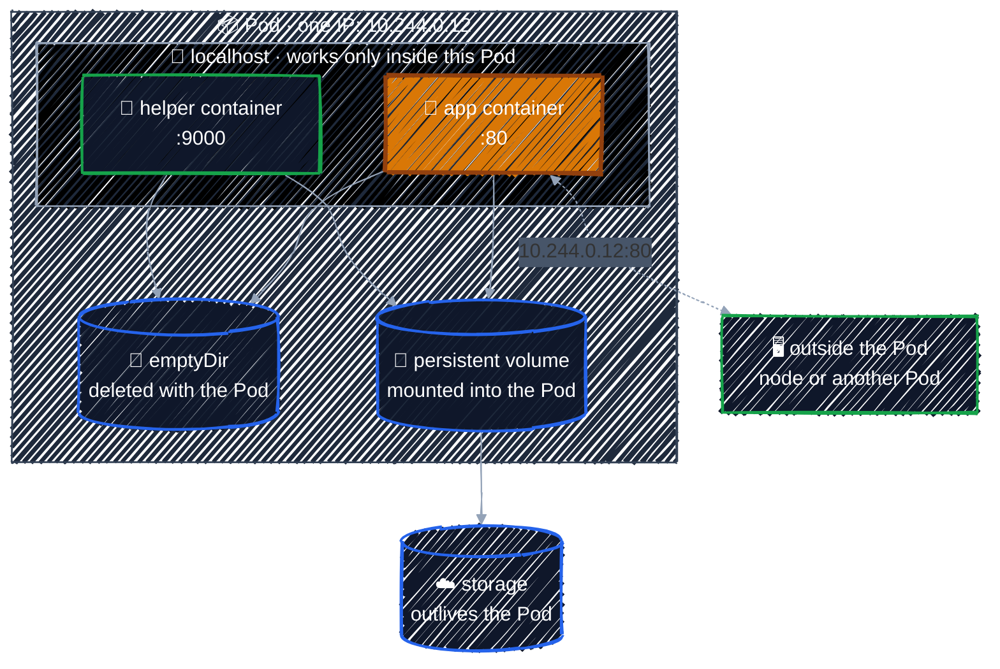

# What Is a Pod

> The smallest thing Kubernetes runs: one (or a few) containers that share a network and storage, scheduled together onto one node.

---

## Before you start

You should have a healthy cluster and be in the `default` namespace:

```bash
kubectl get nodes
kubectl config set-context --current --namespace=default
```

## A Pod is one running instance of your app

You might expect Kubernetes to run *containers* directly. It doesn't: it runs **Pods**. A Pod is a thin wrapper around one or more containers, and it represents **one running instance** of your application.

That last part shapes how you scale. If one copy of your web server isn't enough, you don't add more containers to its Pod. You run **more Pods**, each one a complete, independent copy. Later, a [Deployment](../replicasets-deployments/introduction-to-deployments.md) will do exactly that for you: `replicas: 3` means three Pods.

> **The key idea:** the Pod, not the container, is Kubernetes' unit of scheduling, networking, and lifecycle.

## What containers in a Pod share

Containers in the same Pod are packed much more tightly together than containers in different Pods:



- **One network identity.** Every container in the Pod shares the same IP address and the same set of ports. They reach each other over `localhost`, as if they were processes on one machine. The flip side: two containers in one Pod **can't listen on the same port**. If both try to bind `:80`, the second fails with `address already in use`.
- **Shared storage, if you ask for it.** A volume declared on the Pod can be mounted into any of its containers, so one can write a file and another can read it. How long that data lives depends on the kind of volume:
  - an [`emptyDir`](../volumes/emptydir.md) is scratch space that is **deleted with the Pod**;
  - a [PersistentVolume](../volumes/introduction-to-pvcs.md) lives outside the Pod and **survives** it being deleted and recreated.
- **One node, one lifetime.** All containers in a Pod are always scheduled onto the **same node**. They share the Pod's lifetime: they're created together when the Pod starts and removed together when it's deleted. In between, a single container that crashes can be restarted on its own while the others keep running; [The Pod Lifecycle](pod-lifecycle.md) covers how.

You'll see two containers share a volume hands-on in [Working with emptyDir](../volumes/emptydir.md). (The quick `kubectl run` in [Try it](#try-it) below only creates single-container Pods.)

## One container or several?

Most Pods hold exactly **one** container: your app. Put a second container in the same Pod only when it's a tightly coupled helper that has to sit right next to the app, such as:

- a log shipper that reads the app's log files from a shared volume;
- a proxy that handles TLS or traffic in front of the app on `localhost`.

These helpers are called **sidecars** (see the official [sidecar containers](https://kubernetes.io/docs/concepts/workloads/pods/sidecar-containers/) docs). If two containers could run on different machines and talk over the network, they belong in **separate Pods**, so each can be scaled and restarted on its own.

## Every Pod gets its own IP

Each Pod gets its own IP address from the Pod network, assigned by the CNI (flannel, on this cluster; see [The Data Plane](../getting-started/data-plane.md)). By default, **every Pod can reach every other Pod** directly by that IP, on any node, with no NAT in between.

Two consequences you'll meet later:

- **Open by default isn't always what you want.** To restrict which Pods may talk to which, you add a [NetworkPolicy](../running-and-operating/security-basics.md#networkpolicy-namespaces-are-not-firewalls).
- **Pod IPs aren't stable.** When a Pod is replaced, the new one gets a different IP. That's why clients don't talk to Pod IPs directly. They go through a [Service](../services/what-are-services.md), which gives a group of Pods one stable address.

## What you can configure per container

A Pod lets you configure each of its containers in a lot of ways. You don't need any of these yet; later chapters cover each one:

| Setting | What it controls |
|---|---|
| Image | Which container image to run |
| Ports | Which ports the container listens on |
| Environment variables | Config passed in as env vars |
| Volume mounts | Files and storage mounted into the container |
| Probes | How Kubernetes checks the container is healthy, and what it does when it isn't |
| Resources | How much CPU and memory it reserves and may use |
| Security context | Which user it runs as, and what it's allowed to do |

## Try it

Create a Pod with a single command. ([Creating Pods](creating-pods.md) covers this command and its options in detail.)

```bash
kubectl run web --image=nginx:1.27
kubectl wait --for=condition=Ready pod/web --timeout=60s
kubectl get pods -o wide        # note the IP column and the node it landed on
```

Now prove that Pods reach each other directly. Grab the Pod's IP, then start a second, throwaway Pod and fetch the nginx page from it:

```bash
POD_IP=$(kubectl get pod web -o jsonpath='{.status.podIP}')
kubectl run tmp --rm -it --image=busybox:1.36 -- wget -qO- http://$POD_IP
```

You should see nginx's `Welcome to nginx!` HTML. The `tmp` Pod deletes itself when the command exits (`--rm`).

Finally, delete the `web` Pod. If you use [k9s](../cluster-setup/k9s.md), open it in a second terminal on the `:pods` screen first, so you can watch it happen:

```bash
kubectl delete pod web
kubectl get pods                # gone, and nothing brings it back
```

The Pod disappears, and no replacement ever shows up.

## You rarely create bare Pods

That last step is the catch. A standalone Pod has no safety net: delete it, or let its node fail, and it's simply **gone**, because nothing is watching over it. In practice you almost never run bare Pods. Instead, a controller like a [Deployment](../replicasets-deployments/introduction-to-deployments.md) creates and manages Pods for you: it keeps the desired number running, replaces dead ones, and rolls out new versions. Understanding the bare Pod first is what makes those controllers make sense.

---

[← Inspect with k9s](../cluster-setup/k9s.md) · [↑ Contents](../../README.md) · [The Pod Lifecycle →](pod-lifecycle.md)
