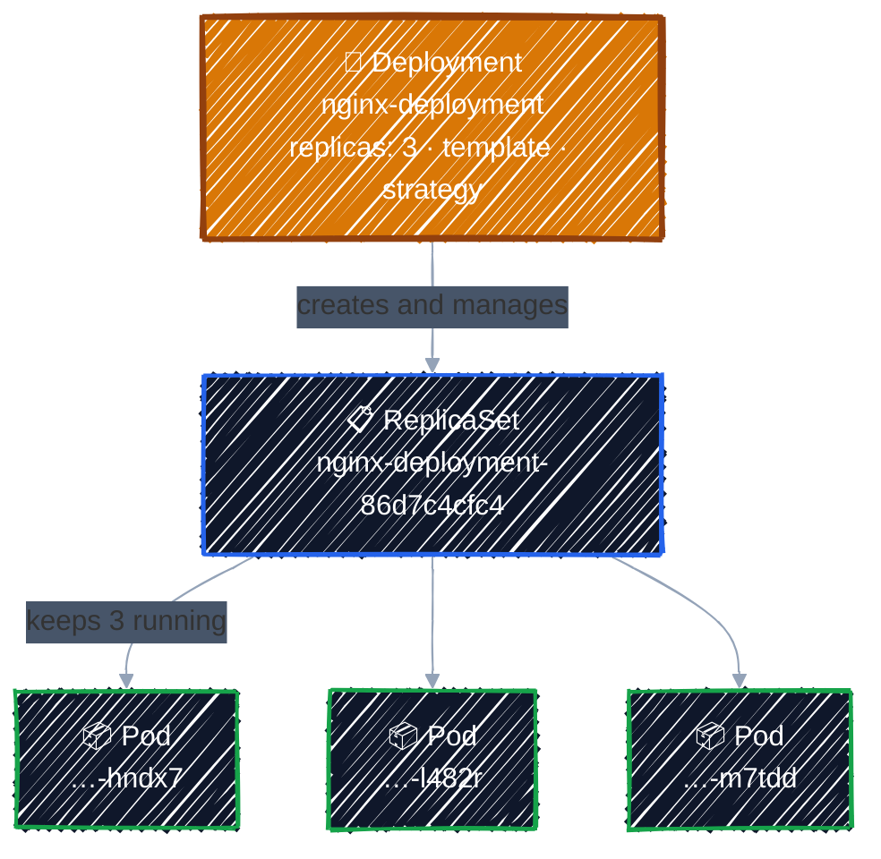

# Introduction to Deployments

> The object that manages ReplicaSets for you, and why you use it instead of a ReplicaSet.

---

The last four chapters showed what a ReplicaSet is good at, and where it stops. It keeps the right **number** of Pods alive, replacing any that disappear. But in [ReplicaSets Can't Update Pods](replicaset-updates.md), upgrading nginx from `1.27` to `1.28` left you with a choice between two versions running side by side, an outage, or replacing Pods by hand one at a time.

A **Deployment** is the object that does that last part for you. It sits one level above ReplicaSets and manages them, the way a ReplicaSet manages Pods. It's what you'll use for almost every app you run on Kubernetes: you get the ReplicaSet's self-healing, plus safe upgrades, rollbacks, and a history of versions.

This chapter is the idea. You'll create one in [Creating and Managing Deployments](creating-deployments.md).

## Three layers

A Deployment doesn't create Pods itself. It creates a ReplicaSet, and the ReplicaSet creates the Pods:



Each layer has one job:

| Layer | Its job | You touch it? |
|---|---|---|
| **Deployment** | Decide *which version* should run, and move between versions safely | **Yes**: this is the object you write and apply |
| **ReplicaSet** | Keep *N* Pods of one version running | No, the Deployment manages it |
| **Pod** | Run the containers | No, the ReplicaSet manages it |

The names show the chain. The ReplicaSet is named after the Deployment plus a hash of the Pod template (`nginx-deployment-86d7c4cfc4`), and each Pod is named after its ReplicaSet plus a random suffix (`nginx-deployment-86d7c4cfc4-hndx7`). The Deployment also adds that hash as a label, `pod-template-hash=86d7c4cfc4`, to the ReplicaSet's selector and its Pods. That keeps each version's ReplicaSet from [adopting](replicaset-existing-pods.md) another version's Pods, even though they all carry `app: nginx`.

Self-healing works exactly as before: delete a Pod, and its ReplicaSet replaces it. The Deployment adds what comes **on top**.

## The manifest

A Deployment manifest looks almost exactly like the [ReplicaSet](what-are-replicasets.md#reading-a-replicaset-manifest) one:

▶ **Runnable manifest:** [`manifests/replicasets-deployments/nginx-deployment.yaml`](../../manifests/replicasets-deployments/nginx-deployment.yaml)

```yaml
apiVersion: apps/v1
kind: Deployment                  # was: ReplicaSet
metadata:
  name: nginx-deployment
  labels:
    app: nginx
spec:
  replicas: 3                     # same meaning: how many Pods
  selector:                       # same: how to find them
    matchLabels:
      app: nginx
  template:                       # same: how to make one
    metadata:
      labels:
        app: nginx
    spec:
      containers:
        - name: nginx
          image: nginx:1.27
  strategy:                       # new: how to move to a new version
    type: RollingUpdate
```

`replicas`, `selector`, and `template` mean what they meant for a ReplicaSet; the Deployment passes them on to the ReplicaSet it creates. The new field is **`strategy`**: what to do when the template changes. `RollingUpdate` is the default, so you'll often see manifests leave it out.

## What happens when you change the template

This is the part a ReplicaSet couldn't do. Change the image to `1.28` and apply. The Deployment doesn't edit the existing ReplicaSet. It creates a **second** ReplicaSet with the new template, then moves Pods across: scale the new one up a little, scale the old one down a little, and repeat.

```mermaid
---
config:
  look: handDrawn
  theme: default
  themeVariables:
    fontFamily: '"Comic Sans MS", "Comic Sans", "Segoe Print", "Bradley Hand", cursive'
    lineColor: '#94A3B8'
    edgeLabelBackground: '#475569'
  themeCSS: |
    .edgeLabel, .edgeLabel p, .edgeLabel span { color: #FFFFFF !important; }
---
flowchart LR
    subgraph s1["1 · start"]
        direction TB
        a1["📋 old RS · 1.27<br/>✅✅✅"]
        b1["📋 new RS · 1.28<br/>(none yet)"]
    end
    subgraph s2["2 · midway"]
        direction TB
        a2["📋 old RS · 1.27<br/>✅✅"]
        b2["📋 new RS · 1.28<br/>✅⏳"]
    end
    subgraph s3["3 · done"]
        direction TB
        a3["📋 old RS · 1.27<br/>(0 Pods, kept)"]
        b3["📋 new RS · 1.28<br/>✅✅✅"]
    end
    s1 --> s2 --> s3

    classDef ctrl fill:#0F172A,stroke:#2563EB,stroke-width:2px,color:#FFFFFF
    classDef tgt fill:#0F172A,stroke:#16A34A,stroke-width:2px,color:#FFFFFF
    class a1,a2,a3 ctrl
    class b1,b2,b3 tgt

    style s1 fill:#1E293B,stroke:#334155,color:#F1F5F9,fillStyle:solid
    style s2 fill:#1E293B,stroke:#334155,color:#F1F5F9,fillStyle:solid
    style s3 fill:#1E293B,stroke:#334155,color:#F1F5F9,fillStyle:solid
```



✅ is a ready Pod, ⏳ one that's still starting. Midway there are **four** Pods, one more than `replicas: 3`, but only **three** are ready: the Deployment starts one extra Pod first, and removes an old one only once a new one is ready. That's how it upgrades without ever having fewer than three Pods serving.

Here's what actually happened on a real cluster, upgrading the three nginx Pods. Each cell is the number of Pods that ReplicaSet has, and how many of them are ready:

| Step | Old ReplicaSet (`1.27`) | New ReplicaSet (`1.28`) | Ready in total |
|---|---|---|---|
| 1. The new ReplicaSet starts its first Pod | 3 (3 ready) | 1 (0 ready) | 3 |
| 2. That Pod is ready: one old Pod goes, the next new one starts | 2 (2 ready) | 2 (1 ready) | 3 |
| 3. The second new Pod is ready: same again | 1 (1 ready) | 3 (2 ready) | 3 |
| 4. The third new Pod is ready: the last old one goes | 0 | 3 (3 ready) | 3 |

The pattern is "one new Pod ready, one old Pod out", repeated until no old Pods are left. There are never more than **4** Pods, and never fewer than **3** ready ones.

Two limits shape every step. With the default `RollingUpdate` settings, `maxSurge: 25%` and `maxUnavailable: 25%`, a 3-replica Deployment may run at most **one extra** Pod (25% of 3, rounded up), and may have **zero** Pods unavailable (25% of 3, rounded down). So it never drops below three ready Pods: the outage from the ReplicaSet chapter doesn't happen. You'll tune these two knobs in [Understanding Rollouts](understanding-rollouts.md).

When it's done, the old ReplicaSet is **kept**, scaled to zero. That's the Deployment's history: each ReplicaSet is one revision, and going back to a previous version means scaling its ReplicaSet back up.

> The other strategy, `type: Recreate`, deletes all old Pods first and only then creates new ones. That causes a short outage, like deleting all the ReplicaSet's Pods did. Use it only when two versions of your app must never run at the same time, for example because they'd fight over the same database schema.

## What a Deployment adds

| Feature | What it means | Where you'll try it |
|---|---|---|
| **Rolling updates** | Replace old Pods with new ones gradually, without downtime | [Updating the Pod Template](updating-pod-template.md) |
| **Rollbacks** | Return to a previous version when something goes wrong | [Understanding Rollouts](understanding-rollouts.md) |
| **Revision history** | Each template change is a numbered revision you can list and inspect (`kubectl rollout history`) | [Understanding Rollouts](understanding-rollouts.md) |
| **Declarative scaling** | Change `replicas` in the file and apply, as with a ReplicaSet | [Scaling Deployments](scaling-deployments.md) |
| **Controlled, observable rollouts** | Watch progress, pause it, and notice when a new version doesn't come up | [Troubleshooting Failed Rollouts](troubleshooting-rollouts.md) |

Compare that with the table at the end of [ReplicaSets Can't Update Pods](replicaset-updates.md#what-youd-need-instead): every row a ReplicaSet couldn't do, a Deployment can.

## Peek at the three layers

You'll work with Deployments properly in the next chapter, but you can see the layers right now. Apply the manifest, and list all three kinds at once, with their labels:

```bash
kubectl apply -f manifests/replicasets-deployments/nginx-deployment.yaml
kubectl rollout status deployment/nginx-deployment
kubectl get deploy,rs,pods --show-labels
```

```text
NAME                               READY   UP-TO-DATE   AVAILABLE   AGE   LABELS
deployment.apps/nginx-deployment   3/3     3            3           2s    app=nginx

NAME                                          DESIRED   CURRENT   READY   AGE   LABELS
replicaset.apps/nginx-deployment-86d7c4cfc4   3         3         3       2s    app=nginx,pod-template-hash=86d7c4cfc4

NAME                                    READY   STATUS    RESTARTS   AGE   LABELS
pod/nginx-deployment-86d7c4cfc4-hndx7   1/1     Running   0          2s    app=nginx,pod-template-hash=86d7c4cfc4
pod/nginx-deployment-86d7c4cfc4-l482r   1/1     Running   0          2s    app=nginx,pod-template-hash=86d7c4cfc4
pod/nginx-deployment-86d7c4cfc4-m7tdd   1/1     Running   0          2s    app=nginx,pod-template-hash=86d7c4cfc4
```

One Deployment, one ReplicaSet named after it, three Pods named after the ReplicaSet, and the `pod-template-hash` label tying them together. (`kubectl rollout status` waits until the Deployment is done rolling out; [Understanding Rollouts](understanding-rollouts.md) covers it.) Delete it for now; the next chapter starts fresh:

```bash
kubectl delete -f manifests/replicasets-deployments/nginx-deployment.yaml
```

Deleting the Deployment deletes its ReplicaSet, and with it the Pods, all the way down.

## When to use one

**Almost always.** For any app that runs continuously and doesn't need a stable identity or its own disk, such as a web server, an API, or a worker, write a Deployment. You'll rarely write a ReplicaSet yourself; it's the part of a Deployment that does the counting.

A few workloads need a different controller, which later chapters cover:

| Workload | Controller |
|---|---|
| Stateless apps (most things) | **Deployment** |
| One Pod per node, like a log agent | [DaemonSet](../core-objects/daemonset.md) |
| Run to completion, like a batch job | [Job & CronJob](../core-objects/job-cronjob.md) |
| Stable names and per-Pod storage, like a database | [StatefulSet](../statefulsets/introduction-to-statefulsets.md) |

## Best practices

- **Use a Deployment, not a bare ReplicaSet or Pod**, for anything that should keep running.
- **Change your app through the Deployment's template**, never by editing its ReplicaSets or Pods. The Deployment would undo it, or leave it behind in an old revision.
- **Leave the old ReplicaSets alone.** They're your rollback history, not leftovers to clean up.
- **Stick with `RollingUpdate`** unless two versions truly can't run side by side.

---

[← ReplicaSets and Existing Pods](replicaset-existing-pods.md) · [↑ Contents](../../README.md) · [Creating and Managing Deployments →](creating-deployments.md)
