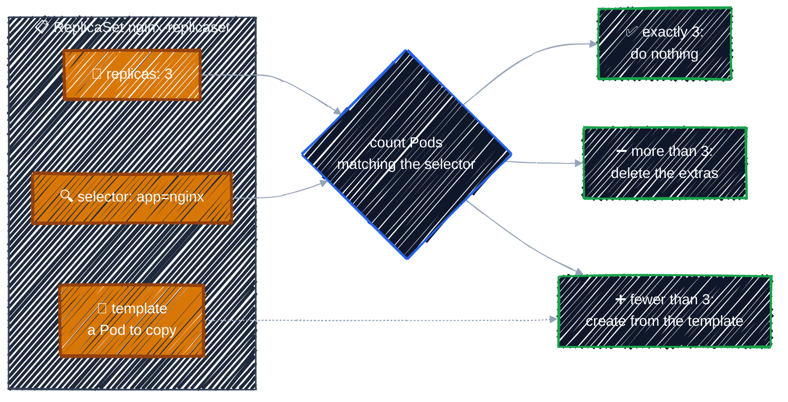

# What Are ReplicaSets

> Keep a fixed number of identical Pods running, and replace any that disappear.

---

So far you've run every Pod by hand, one at a time. That has a cost you saw in [Working with Pods](../pods/working-with-pods.md#clean-up): delete a bare Pod, or lose the node it runs on, and it's simply **gone**. Nothing brings it back, and if you want three copies of nginx, you start and watch all three yourself.

A **ReplicaSet** takes over that job. You tell it *how many* identical Pods you want, and it keeps exactly that many running: it creates Pods when there are too few, and deletes them when there are too many.

This chapter is about the idea, and about **labels and selectors**, the mechanism a ReplicaSet uses to find its Pods. You'll create one in the [next chapter](creating-replicasets.md).

## Desired count, actual count, and a loop

A ReplicaSet holds three things: how many Pods you want (`replicas`), how to recognize its Pods (the `selector`), and how to make a new one (the Pod `template`). A controller in the [control plane](../getting-started/control-plane.md) runs a loop over them, again and again:



That's the whole job. It doesn't matter *why* the count is wrong: someone ran `kubectl delete pod`, a Pod was evicted, a node died and its Pods were lost. The loop only sees "two Pods, I want three" and makes one more. This is the [declarative model](../getting-started/what-is-kubernetes.md#imperative-vs-declarative) at work: you state the goal, and a controller keeps closing the gap.

## Labels and selectors

How does the ReplicaSet know which Pods are "its" Pods? Not by name, and not by keeping a list. It **asks**, every time: "which Pods carry these labels?" Labels and selectors are how almost everything in Kubernetes finds everything else, so they're worth understanding properly.

### Labels: tags on an object

A **label** is a key-value pair in an object's `metadata.labels`. You've been adding them since Part 3: `--labels=app=nginx` on `kubectl run`, and `app: nginx` in every manifest. Labels mean nothing to Kubernetes on their own. They're tags you choose, for you and for other objects to search by.

### Selectors: a query over labels

A **selector** is a query that matches objects by their labels. You can run selectors yourself with `kubectl get -l`. Make three Pods with different labels:

```bash
kubectl run web-1 --image=nginx:1.27 --labels=app=nginx,tier=web
kubectl run web-2 --image=nginx:1.27 --labels=app=nginx,tier=api
kubectl run other --image=nginx:1.27 --labels=app=redis,tier=cache
kubectl get pods --show-labels
```

```text
NAME    READY   STATUS    RESTARTS   AGE   LABELS
other   1/1     Running   0          5s    app=redis,tier=cache
web-1   1/1     Running   0          5s    app=nginx,tier=web
web-2   1/1     Running   0          5s    app=nginx,tier=api
```

Now query them:

| Selector | Matches | Means |
|---|---|---|
| `-l app=nginx` | `web-1`, `web-2` | the label equals this value |
| `-l app=nginx,tier=web` | `web-1` | a comma means **and**: every condition must hold |
| `-l 'app!=nginx'` | `other` | the label doesn't equal this value |
| `-l 'tier in (web,cache)'` | `web-1`, `other` | the label is one of these values |
| `-l tier` | all three | the label exists, with any value |

```bash
kubectl get pods -l app=nginx
```

```text
NAME    READY   STATUS    RESTARTS   AGE
web-1   1/1     Running   0          10s
web-2   1/1     Running   0          10s
```

A ReplicaSet's selector is exactly this kind of query, stored in the object and re-run continuously. So is a [Service's](../core-objects/service.md): it sends traffic to whichever Pods match its selector right now.

> **The catch:** a selector matches **any** Pod with the right labels, including Pods the ReplicaSet didn't create. [ReplicaSets and Existing Pods](replicaset-existing-pods.md) shows what happens then.

Delete the three Pods before moving on:

```bash
kubectl delete pod web-1 web-2 other
```

## Reading a ReplicaSet manifest

Here's a ReplicaSet that keeps three nginx Pods running:

▶ **Runnable manifest:** [`manifests/replicasets-deployments/nginx-replicaset.yaml`](../../manifests/replicasets-deployments/nginx-replicaset.yaml)

```yaml
apiVersion: apps/v1               # ReplicaSets live in the apps group
kind: ReplicaSet
metadata:
  name: nginx-replicaset
  labels:
    app: nginx                    # labels on the ReplicaSet itself
spec:
  replicas: 3                     # 1. how many Pods
  selector:                       # 2. how to find them
    matchLabels:
      app: nginx
  template:                       # 3. how to make one
    metadata:
      labels:
        app: nginx                #    every new Pod gets this label…
    spec:
      containers:
        - name: nginx
          image: nginx:1.27
```

The `template` is a Pod manifest without its `apiVersion` and `kind`: just `metadata` and `spec`, as in [Manifest Files](../object-management/manifest-files.md). It has no `name` either, because every Pod made from it gets a generated one, like `nginx-replicaset-7xkq2`.

There are two kinds of labels here, and they do different jobs:

| Where | Whose labels | Used for |
|---|---|---|
| `metadata.labels` | The ReplicaSet's own | Finding the ReplicaSet itself, e.g. `kubectl get rs -l app=nginx` |
| `spec.template.metadata.labels` | Every Pod it creates | Being found **by the selector** |

### The template's labels must match the selector

If the selector didn't match the template's labels, the ReplicaSet would create a Pod, fail to count it, create another, and never stop. The API server refuses that up front. Try it on a copy: change only the template's label to `app: web`, and check it with a [server dry run](../object-management/manifest-files.md#catch-mistakes-before-they-reach-the-cluster):

```bash
cp manifests/replicasets-deployments/nginx-replicaset.yaml /tmp/nginx-replicaset.yaml
sed -i 's/^        app: nginx$/        app: web/' /tmp/nginx-replicaset.yaml   # 8 spaces: only the template's label
kubectl apply --dry-run=server -f /tmp/nginx-replicaset.yaml
rm /tmp/nginx-replicaset.yaml
```

```text
The ReplicaSet "nginx-replicaset" is invalid: spec.template.metadata.labels: Invalid value: map[string]string{"app":"web"}: `selector` does not match template `labels`
```

The selector is also **required**: leave it out, and you get `spec.selector: Required value`.

> `matchLabels` covers most cases. For the `in`, `!=`, and "exists" forms from the table above, a selector uses `matchExpressions` instead (`kubectl explain replicaset.spec.selector`). You'll rarely need it.

## What a ReplicaSet does, and doesn't do

| Situation | The ReplicaSet… |
|---|---|
| A Pod is deleted or evicted | creates a replacement from the template |
| A container in a Pod crashes | **nothing**. The kubelet restarts the container inside the same Pod, as in [The Pod Lifecycle](../pods/pod-lifecycle.md). The Pod still exists, so the count is still right, even in `CrashLoopBackOff` |
| The node running a Pod dies | eventually replaces the lost Pods on a healthy node |
| You raise `replicas` | creates the extra Pods |
| You lower `replicas` | deletes Pods until the count matches |
| You change the template, e.g. a new image | **nothing** to the Pods already running, only to Pods it creates later. See [ReplicaSets Can't Update Pods](replicaset-updates.md) |

That last row is the big limitation. A ReplicaSet keeps *a number* of Pods alive; it has no idea how to move them from one version to another. That job belongs to a [Deployment](introduction-to-deployments.md), which creates and manages ReplicaSets for you. In practice you'll rarely write a ReplicaSet yourself. But every Deployment you create runs on one, so knowing what it does tells you what your Deployments are doing underneath.

## Best practices

- **Don't run important Pods bare.** Anything that should keep running belongs under a controller. Use a [Deployment](introduction-to-deployments.md), which brings its ReplicaSet with it.
- **Give selectors specific labels**, like `app: nginx` rather than something every Pod has, so a selector never picks up Pods that aren't its own.
- **Keep the template's labels and the selector in sync.** The API server rejects a mismatch, but only when you apply.
- **Use `kubectl get -l`** to see exactly which Pods a selector matches before you rely on it.

---

[← Multiple Objects in One File](../object-management/multiple-objects-per-file.md) · [↑ Contents](../../README.md) · [Creating and Managing ReplicaSets →](creating-replicasets.md)
