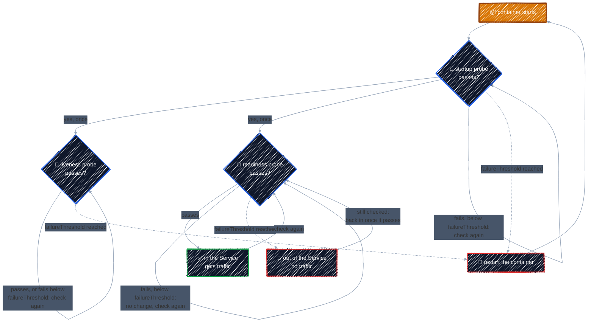

# Health Probes

> The three questions startup, liveness, and readiness probes answer, how a probe checks, and what Kubernetes does when one fails.

---

Kubernetes already restarts a container whose process exits, as you saw in [Pod Lifecycle](../pods/pod-lifecycle.md#crashloopbackoff). But a process that's still running isn't necessarily well. It might still be loading, and not answer yet. It might be stuck in a deadlock, running forever and answering nothing. Or it might be fine, but briefly unable to serve, because a database it needs is down. From the outside, all of these look the same: the process is there.

A **probe** is a check that Kubernetes runs against a container, over and over, to tell these cases apart. There are three kinds, each asking a different question, and each with a different consequence when the answer is no. This chapter explains all three. The chapters after it add health endpoints to color-api, and set up each probe in turn.

## Before you start

You only need a running cluster. This chapter only looks; it doesn't create anything.

## 1. Three probes, three questions

| Probe | Asks | When it runs | If it fails too often |
|---|---|---|---|
| **Startup** | Has the app finished starting? | From when the container starts, until it passes once | The container is restarted |
| **Liveness** | Is the app still working? | Once the startup probe passes (from the start, if there's none), for the container's whole life | The container is restarted |
| **Readiness** | Can the app take traffic right now? | Once the startup probe passes (from the start, if there's none), for the container's whole life | The Pod is taken out of its Services. Nothing is restarted |

The startup probe comes first, and holds the other two back. While it runs, liveness and readiness aren't checked at all, so a slow-starting app isn't restarted for being slow. Once it passes, it doesn't run again until the container restarts, and the other two take over, side by side:



`failureThreshold` is how many failures **in a row** it takes before Kubernetes acts; [step 3](#3-when-it-counts-as-failing) covers it and the other timing settings.

The difference between the last two is the important one. A failed **liveness** probe means "this container is broken, and only a restart will fix it". A failed **readiness** probe means "don't send it requests for now". Readiness keeps checking, and when it passes again, the Pod is put back in its Services. Nothing was restarted, and nothing was lost.

Readiness also paces rollouts. A Deployment counts a new Pod as available only once it's ready, and it doesn't retire the next old Pod until enough new ones are, as in [Understanding Rollouts](../replicasets-deployments/understanding-rollouts.md#5-control-the-pace). Without a readiness probe, "ready" just means "running", so a rollout can replace every old Pod with new ones that can't serve yet.

Every probe is optional. A container without a startup probe goes straight to the other two. One without a liveness probe is only restarted when its process exits. One without a readiness probe counts as ready as soon as it's running, which is what all your Pods so far have done.

## 2. How a probe checks

The **kubelet** on the Pod's node runs the probes, not the control plane. Each probe uses one of four ways to check:

| Kind | Passes when | Good for |
|---|---|---|
| `httpGet` | An HTTP request to a path and port gets a status from 200 to 399 | Web apps and APIs: the most common kind |
| `tcpSocket` | A TCP connection to a port can be opened | Apps that listen but don't speak HTTP, like many databases |
| `exec` | A command run inside the container exits with `0` | Anything you can check with a command |
| `grpc` | A gRPC health check returns `SERVING` | gRPC services |

An `httpGet` probe is only as good as the endpoint it calls. If `/` just returns a static page, it passes even when the app behind it is stuck. That's why apps get endpoints made for probes, like `/health` and `/ready`, which check what really matters. You'll add them to color-api in the [next chapter](color-api-health-endpoints.md).

## 3. When it counts as failing

One failed check doesn't mean much: a request can time out once on a busy node. So each probe has settings for how often to check, and how many failures in a row it takes:

| Setting | Means | Default |
|---|---|---|
| `initialDelaySeconds` | Wait this long after the container starts before the first check | `0` |
| `periodSeconds` | Check this often | `10` |
| `timeoutSeconds` | Count a check as failed if it takes longer than this | `1` |
| `failureThreshold` | This many failures **in a row** make the probe fail | `3` |
| `successThreshold` | This many successes in a row make it pass again. Must be `1` for liveness and startup | `1` |

`periodSeconds × failureThreshold` is roughly how long a problem lasts before Kubernetes acts. With the defaults, that's about 30 seconds. For a startup probe, it's the most time the app gets to start: `failureThreshold: 30` with `periodSeconds: 10` gives it five minutes.

## 4. Probes you already have

The cluster's own components use probes. The API server has all three:

```bash
kubectl describe pod -n kube-system -l component=kube-apiserver | grep -E 'Liveness|Readiness|Startup'
```

```text
    Liveness:     http-get https://172.28.125.129:6443/livez delay=10s timeout=15s period=10s #success=1 #failure=8
    Readiness:    http-get https://172.28.125.129:6443/readyz delay=0s timeout=15s period=1s #success=1 #failure=3
    Startup:      http-get https://172.28.125.129:6443/livez delay=10s timeout=15s period=10s #success=1 #failure=24
```

Your IP address will differ: it's your node's. Each line is one probe, in the settings from step 3: `delay` is `initialDelaySeconds`, `#failure` is `failureThreshold`, and so on. Read them as answers to the three questions:

- **Startup**: calls `/livez` every 10 seconds, and allows 24 failures. The API server gets about four minutes to start, for the times it's slow.
- **Liveness**: calls the same `/livez`, but gives up after 8 failures, about 80 seconds. Once it's up, a long silence means it's stuck.
- **Readiness**: calls a different endpoint, `/readyz`, **every second**, and marks the Pod not ready after 3 failures. Whether it can serve right now has to be known quickly. The API server isn't behind a Service that selects its Pod, so here that only changes its `READY` column. An ordinary Pod would be taken out of its Services at that point.

Readiness is also what the `READY` column has shown all along. `1/1` means one container, and one of them ready. For a Pod without a readiness probe, that's simply "running".

## 5. Common mistakes

Probes are easy to get wrong in ways that make things worse, not better:

- **A liveness probe that checks other services.** If `/health` fails whenever the database is down, every Pod's liveness fails at once, and they're all restarted, over and over, while the database recovers. A restart doesn't fix a database. That's a readiness question: "I can't serve right now".
- **A long `initialDelaySeconds` on liveness, instead of a startup probe.** It has to be long enough for the slowest start, so a container that hangs right after a fast start goes unnoticed for just as long. A startup probe waits only as long as the start actually takes.
- **Liveness and readiness on the same endpoint, with the same settings.** Then a brief overload makes the Pod unready and restarts it at the same moment. Liveness should be more patient than readiness, as the API server's are.
- **A timeout that's too short.** The default `timeoutSeconds` is 1 second. An app that's slow under load can fail its probe while it's still working, and be restarted when it's busiest.

## Best practices

- **Give every long-running app a readiness probe.** Without one, a Pod gets traffic, and counts as available in a rollout, as soon as its process starts.
- **Use endpoints made for probes**, like `/health` and `/ready`, not your app's home page.
- **Check each probe against the mistakes in step 5** before you ship it: what it checks, how patient it is, and how long its timeout is.
- **When a container keeps restarting without crashing, suspect its liveness probe.** `kubectl describe pod` shows `Liveness probe failed` events when that's the cause.

---

[← Rollouts Under a Quota](rollouts-and-quotas.md) · [↑ Contents](../../README.md) · [Color API v1.2: Health Endpoints →](color-api-health-endpoints.md)
