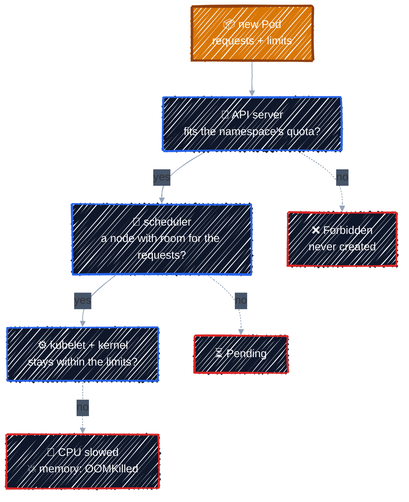

# Introduction to Resource Quotas, Requests, and Limits

> What requests, limits, and resource quotas each control, who enforces them and when, and how they decide together whether a Pod gets to run.

---

[Namespaces](../labels-namespaces/namespaces.md#3-what-a-namespace-does-and-doesnt-separate) left one problem open: every namespace shares the same nodes, so busy Pods in dev can take the CPU and memory prod needs. Within one namespace it's no better. A single app with a memory leak can grow until the node has nothing left for anyone else.

Kubernetes has three tools for this, at two levels:

- **Requests** and **limits** are set on each **container**. A request says how much the container needs; a limit says how much it may use, at most.
- A **resource quota** is set on a **namespace**. It caps the total that all the Pods in that namespace may ask for together.

This chapter explains what each one does, and walks through the decisions they make for a few Pods. You'll create a quota in [Working with Resource Quotas](resource-quotas.md), and watch requests and limits at work in [Setting Requests and Limits](requests-limits.md).

## Before you start

You only need a running cluster. This chapter only looks; it doesn't create anything.

## 1. The units

CPU and memory are counted in their own units, and you'll see both in every example:

| Resource | Unit | Examples |
|---|---|---|
| CPU | Cores, or **millicores** with `m`. `1000m` is one core | `250m` is a quarter of a core. `"1"` and `"1000m"` are the same |
| Memory | Bytes, usually with a binary suffix: `Ki`, `Mi`, `Gi` | `512Mi` is 512 × 1024 × 1024 bytes. `1Gi` is `1024Mi` |

Watch the `i`. `Mi` and `Gi` are powers of 1024; `M` and `G`, without the `i`, are powers of 1000, so `1G` is about 7% less than `1Gi`. Use the `i` forms for memory, and you'll match what `kubectl` shows.

CPU is a share of time, not a whole processor: `250m` means a quarter of one core's time, spread across whichever cores are free.

There's a third resource, with the same units as memory: **`ephemeral-storage`**, the node's disk space that a container uses for its logs, its writable layer, and `emptyDir` volumes. It takes requests and limits like CPU and memory, and a container that goes past its limit is evicted. Durable storage, in PersistentVolumeClaims, is counted separately, by a quota, as step 3 shows.

## 2. Requests and limits: per container

Each container can declare both, under `resources`:

```yaml
containers:
  - name: color-api
    image: <YOUR_DOCKERHUB_USER>/color-api:1.2.0
    resources:
      requests:            # what it needs: reserved on the node
        cpu: 200m
        memory: 256Mi
      limits:              # what it may use, at most
        cpu: 400m
        memory: 512Mi
```

They do different jobs, and they're enforced by different parts of the cluster:

| | Request | Limit |
|---|---|---|
| **Means** | The minimum the container should always have | The maximum the container may ever use |
| **Checked by** | The scheduler, when it picks a node | The kubelet and the Linux kernel, while the container runs |
| **Effect** | The Pod only goes to a node with that much unreserved. Then it's set aside for this Pod | Past the CPU limit, the container is slowed down. Past the memory limit, it's killed |

Requests are a **reservation**, not a measurement. The scheduler doesn't look at how busy a node actually is; it adds up the requests of the Pods already there. You can see that sum on your node:

```bash
kubectl describe node | grep -A 5 'Allocated resources'
```

```text
Allocated resources:
  (Total limits may be over 100 percent, i.e., overcommitted.)
  Resource           Requests    Limits
  --------           --------    ------
  cpu                950m (5%)   0 (0%)
  memory             290Mi (3%)  340Mi (4%)
```

Your numbers will differ. These are the requests of the cluster's own Pods, like CoreDNS and the API server: 950m of CPU is already promised, whether those Pods use it or not. A new Pod only fits if its requests fit in what's left. If no node has room, the Pod stays `Pending`.

Note the `0` under CPU limits: none of these Pods has a CPU limit, and that's allowed. Without a quota, requests and limits are optional, and a container without a limit may use whatever the node has free.

The two limits behave very differently, which is why [Setting Requests and Limits](requests-limits.md) shows each one:

- **CPU can be shared over time**, so a container at its CPU limit is just made to wait. It runs slower, and keeps running.
- **Memory can't be taken back** once it's handed out, so a container that goes past its memory limit is killed, `OOMKilled`, and restarted.

## 3. Resource quotas: per namespace

A **ResourceQuota** sets hard caps for a whole namespace. Here are two, one for each environment from the Namespaces part:

```yaml
apiVersion: v1
kind: ResourceQuota
metadata:
  name: dev-quota
  namespace: dev
spec:
  hard:
    requests.cpu: "1000m"
    requests.memory: "2Gi"
    limits.cpu: "2000m"
    limits.memory: "4Gi"
```

```yaml
apiVersion: v1
kind: ResourceQuota
metadata:
  name: prod-quota
  namespace: prod
spec:
  hard:
    requests.cpu: "6000m"
    requests.memory: "12Gi"
    limits.cpu: "12000m"
    limits.memory: "24Gi"
```

Each line caps a **sum** over every Pod in the namespace. `requests.cpu: "1000m"` means: all of dev's containers together may request one core, no more. Prod gets six times as much, and a busy dev can no longer take what prod needs.

Three things set a quota apart from requests and limits:

- **It's checked by the API server, when a Pod is created.** A Pod that would go over the quota is rejected right away, before the scheduler ever sees it. It isn't `Pending`; it never exists.
- **It counts what Pods declare, not what they use.** The sums are of requests and limits, from the Pods' specs. A Pod that requests 500m and sits idle still uses up 500m of the quota.
- **It can count more than CPU and memory.** A quota can also cap storage, with `requests.storage` for the total size of PersistentVolumeClaims and `requests.ephemeral-storage` for local disk, and the number of objects: Pods, Services, ConfigMaps, and so on.

## 4. How they decide together

Take the dev quota above, and four Pods created in dev, one after the other. Each Pod's numbers add to what the namespace has already used, and every sum must stay within the quota:

| Pod | requests.cpu | requests.memory | limits.cpu | limits.memory | Result |
|---|---|---|---|---|---|
| A | 500m | 1Gi | 1000m | 2Gi | ✓ Created. Used: 500m / 1Gi / 1000m / 2Gi |
| B | 200m | 512Mi | 400m | 1Gi | ✓ Created. Used: 700m / 1536Mi / 1400m / 3Gi |
| C | **400m** | 256Mi | 600m | 512Mi | ✗ Rejected: 700m + 400m of CPU requests is over 1000m |
| D | 200m | 256Mi | 400m | **2Gi** | ✗ Rejected: 3Gi + 2Gi of memory limits is over 4Gi |

One number over is enough. Pod C fits on every count except CPU requests, and Pod D on every count except memory limits. The API server says exactly which one, and by how much:

```text
Error from server (Forbidden): pods "pod-c" is forbidden: exceeded quota: dev-quota, requested: requests.cpu=400m, used: requests.cpu=700m, limited: requests.cpu=1
Error from server (Forbidden): pods "pod-d" is forbidden: exceeded quota: dev-quota, requested: limits.memory=2Gi, used: limits.memory=3Gi, limited: limits.memory=4Gi
```

Even if Pods C and D got past the quota, they'd still face the scheduler, which looks for a node with room for their requests, and later the kubelet, which holds them to their limits. A Pod passes three checks on its way to running:



| | Set on | Checked by | When | If it's exceeded |
|---|---|---|---|---|
| **Resource quota** | A namespace | The API server | When a Pod is created | The Pod is rejected |
| **Request** | A container | The scheduler | When the Pod is placed | The Pod stays `Pending` |
| **Limit** | A container | The kubelet and kernel | While the container runs | CPU is slowed; memory is killed |

## 5. A quota makes requests and limits required

Once a namespace has a quota on CPU or memory, every new Pod there must declare the resources that quota counts. Otherwise there's nothing to add up. A Pod with no `resources` at all is turned away:

The `for:` part names the container that's missing each value; here the Pod and its container are both called `color-api`.

```text
Error from server (Forbidden): pods "color-api" is forbidden: failed quota: dev-quota: must specify limits.cpu for: color-api; limits.memory for: color-api; requests.cpu for: color-api; requests.memory for: color-api
```

Two details make this less strict than it sounds:

- **Limits alone are enough.** If a container sets a limit and no request, Kubernetes uses the limit as the request, too. Only requests, without limits, isn't enough under this quota, because it counts limits.
- **A LimitRange can fill in defaults.** It gives containers that don't declare anything a default request and limit, so they pass the quota. You'll set one up in [Working with Resource Quotas](resource-quotas.md).

There's one trap. The quota checks **Pods**, not Deployments. A Deployment without resources is accepted without a word, in a namespace with a quota. Then its ReplicaSet tries to create Pods, and every one is rejected. `kubectl get deployments` shows `0/1` ready, and the reason only appears on the ReplicaSet:

```text
pods "color-api-67f9b87f74-52smq" is forbidden: failed quota: dev-quota: must specify limits.cpu for: color-api; limits.memory for: color-api; requests.cpu for: color-api; requests.memory for: color-api
```

You'll make this happen on purpose, and fix it, in the next chapter.

## Best practices

- **Set requests on every container.** They're how the scheduler knows what a Pod needs. Without them, it can pack a node with more than it can handle.
- **Set a memory limit on every container.** A leak then kills one container, instead of starving the whole node.
- **Give shared namespaces a quota.** One per environment or team, sized for what it should get, so no namespace can take the cluster.
- **Size requests from real usage.** A request far above what the app uses wastes the quota and the node; one far below lets the node be overbooked.
- **Read the error.** Quota rejections name the resource, what you asked for, what's used, and the cap. That's usually all you need to fix it.

---

[← Cross-Namespace Service Communication](../labels-namespaces/cross-namespace-services.md) · [↑ Contents](../../README.md) · [Working with Resource Quotas →](resource-quotas.md)
