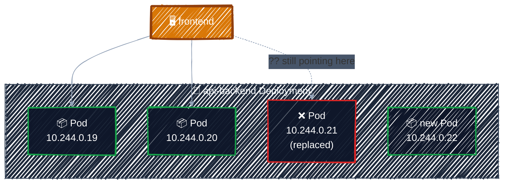
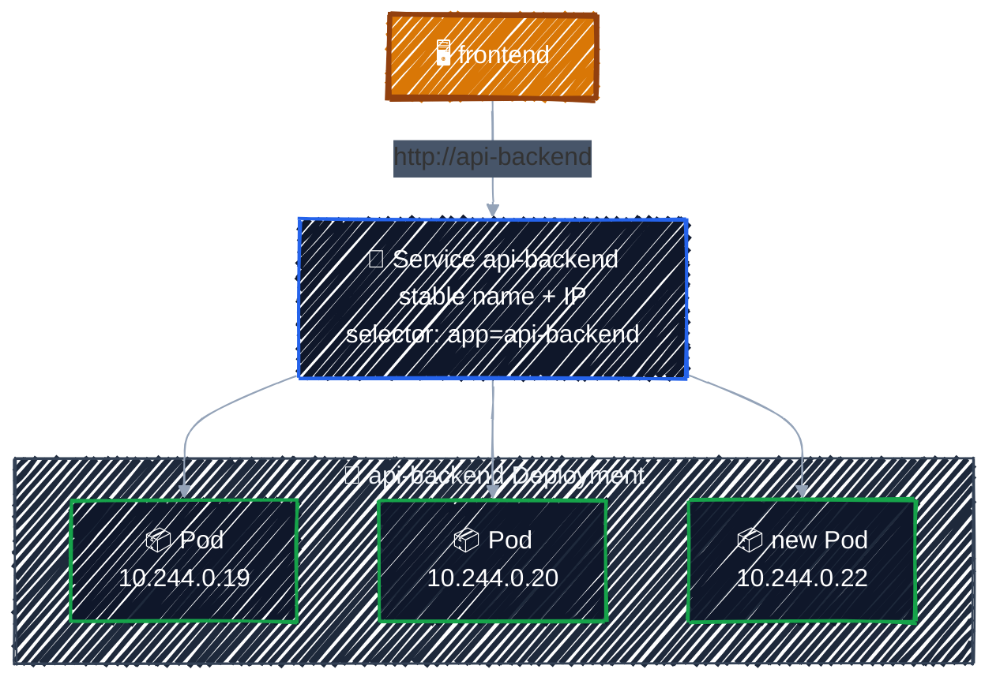

# What Are Services

> A stable name and address in front of a changing set of Pods, and the types of Service.

---

A [Deployment](../replicasets-deployments/introduction-to-deployments.md) keeps your Pods running, but it does so by **replacing** them: a crashed node, a deleted Pod, or an upgrade, and the old Pod is gone and a new one, with a new IP, takes its place. You saw what that means for connecting in [Working with Pods](../pods/working-with-pods.md#4-pod-ip--name-why-you-cant-connect-yet): a Pod's IP changes, its name isn't in DNS, and from outside the cluster you can't reach it at all.

A **Service** fixes that. It gives a group of Pods **one stable address and name**, and forwards each connection to one of the Pods behind it, whichever ones exist right now.

This chapter is the idea and the vocabulary. The rest of this part builds a small two-app setup around [color-api](../pods/from-dockerfile-to-pod.md) and tries each kind of Service on it.

## The problem: Pods come and go

Picture a frontend that calls an API backend running as three Pods. If the frontend talks to the Pods' IPs directly:



The frontend would need to keep track of every Pod's IP, notice when one disappears, and find the replacement (`.22`). Every client of every app would have to do this.

## The fix: one stable front door

Put a Service in between. The frontend only ever talks to the Service, by name, and the Service sends each connection to one of the Pods that exist at that moment:



Three things make that work:

- **A stable address.** A Service gets a virtual IP, its *ClusterIP*, that stays the same for the Service's whole life, however often its Pods are replaced.
- **A stable name.** The cluster's DNS ([CoreDNS](../networking/dns.md)) gives every Service a name, so clients write `http://api-backend` instead of any IP. A Pod's own name normally isn't in DNS at all; the Service's name is what you connect to. (The exception is a [headless Service](../networking/dns.md), which gives each Pod behind it a DNS name of its own; StatefulSets use that.)
- **A selector, not a list.** Like a [ReplicaSet](../replicasets-deployments/what-are-replicasets.md#labels-and-selectors), a Service finds its Pods by **label**, re-evaluated continuously. A new Pod with the right label starts getting traffic as soon as it's ready; a Pod that's gone, or not ready, stops getting any. The current list of matching Pod addresses is kept in an object called **EndpointSlice**.

The forwarding itself is done by **kube-proxy**, on every node: it watches Services and their endpoints, and sets up rules so that traffic to a Service's IP lands on one of its Pods. See [The Data Plane](../getting-started/data-plane.md).

### You're already using one

Your cluster came with a Service before you created anything:

```bash
kubectl get svc
kubectl get endpointslice -l kubernetes.io/service-name=kubernetes
```

```text
NAME         TYPE        CLUSTER-IP   EXTERNAL-IP   PORT(S)   AGE
kubernetes   ClusterIP   10.96.0.1    <none>        443/TCP   4d3h

NAME         ADDRESSTYPE   PORTS   ENDPOINTS        AGE
kubernetes   IPv4          6443    172.28.125.129   4d3h
```

The `kubernetes` Service is how Pods reach the API server: a stable IP (`10.96.0.1`) and name in front of the real API server at your node's address, port `6443`. Its endpoint is your node's IP, so yours will differ.

## The manifest

A Service is a small object. Here's one for color-api, which listens on `8080`. Just read it for now: there's nothing behind it to send traffic to yet. You'll deploy color-api and build its Services step by step, starting in [Deploying Color API and Traffic Generator](deploying-color-api.md).

```yaml
apiVersion: v1
kind: Service
metadata:
  name: color-api
spec:
  type: NodePort           # which kind of Service (below); ClusterIP if left out
  selector:
    app: color-api         # send traffic to Pods with this label
  ports:
    - protocol: TCP
      port: 80             # the Service's own port
      targetPort: 8080     # the port on the Pods
      nodePort: 30007      # NodePort only: the port opened on every node
```

The three ports are easy to mix up. Read them in the order traffic flows:

```text
client ──► nodeIP:nodePort ──► Service IP:port ──► Pod IP:targetPort
              (30007)               (80)               (8080)
           NodePort only
```

| Field | Whose port | Notes |
|---|---|---|
| `port` | The Service's | What clients inside the cluster connect to: `http://color-api:80` |
| `targetPort` | The Pods' | Where the app actually listens. Defaults to the same as `port` if left out |
| `nodePort` | Every node's | Only for `NodePort` (and `LoadBalancer`). Leave it out, and one is picked from `30000–32767` |

`targetPort` can also be a **name**, like `http`, matching a named `containerPort` in the Pod. Then you can change the container's port number without touching the Service.

## The types of Service

`spec.type` decides **who can reach** the Service:

| Type | Behavior | Use it for | Where you'll try it |
|---|---|---|---|
| **ClusterIP** (default) | A stable IP and DNS name, reachable **only inside the cluster** | Apps talking to each other, like a frontend calling an API. Often fronted by an [Ingress](../networking/ingress.md) for HTTP from outside | [ClusterIP Services](clusterip-services.md) |
| **NodePort** | A ClusterIP, **plus** a port opened on every node, reachable at `<NodeIP>:<nodePort>` | Exposing something outside the cluster without a load balancer, typically for development and testing | [NodePort Services](nodeport-services.md) |
| **LoadBalancer** | A NodePort, **plus** an external IP from a cloud provider's load balancer | Production traffic from outside, on a cloud | Below |
| **ExternalName** | **No** Pods and no proxying: the Service's name is a DNS alias for an outside hostname | Letting in-cluster apps reach an external service by an in-cluster name | [ExternalName Services](externalname-services.md) |

The first three build on each other: every NodePort Service is also a ClusterIP Service, and every LoadBalancer Service is also a NodePort Service. ExternalName is the odd one out.

### LoadBalancer on a bare kubeadm cluster

`type: LoadBalancer` asks *something* to create an external load balancer. On a cloud provider, the cloud does it. Your kubeadm cluster has no cloud, so nothing answers. Try it:

```bash
kubectl create service loadbalancer lb-demo --tcp=80:8080
kubectl get svc lb-demo
```

```text
NAME      TYPE           CLUSTER-IP     EXTERNAL-IP   PORT(S)        AGE
lb-demo   LoadBalancer   10.96.54.184   <pending>     80:32306/TCP   5s
```

`EXTERNAL-IP` stays `<pending>` forever. Notice it still got a ClusterIP **and** a node port (`32306`): the layers underneath work fine, only the external IP never arrives. To make `LoadBalancer` work on your own hardware, install a load balancer implementation such as [MetalLB](https://metallb.universe.tf/). For this lab, `NodePort` does the job. Clean up:

```bash
kubectl delete svc lb-demo
```

## What's in this part

| Chapter | What you'll do |
|---|---|
| [Traffic Generator](traffic-generator.md) | Build a small app that keeps calling color-api, and prints which Pod answered |
| [Deploying Color API and Traffic Generator](deploying-color-api.md) | Run both as Deployments |
| [ClusterIP Services](clusterip-services.md) | Connect them inside the cluster, and watch requests spread across Pods |
| [NodePort Services](nodeport-services.md) | Open color-api to traffic from outside, and reach it from your laptop |
| [ExternalName Services](externalname-services.md) | Give an outside hostname an in-cluster name |

## Best practices

- **Default to ClusterIP.** Only expose what really needs to be reached from outside the cluster.
- **Talk to Services by DNS name**, never by Pod IP, or even by the Service's IP.
- **Keep the selector labels stable** and specific to one app, so the Service always finds exactly its Pods.
- **Name your container ports**, and use the name as `targetPort`, so the port number can change in one place.

---

[← Troubleshooting Failed Rollouts](../replicasets-deployments/troubleshooting-rollouts.md) · [↑ Contents](../../README.md) · [Traffic Generator →](traffic-generator.md)
