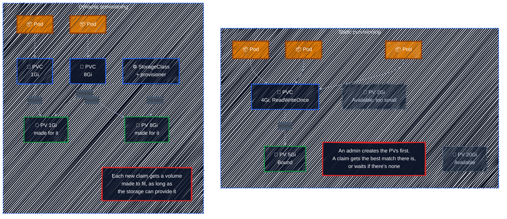

# Introduction to Persistent Volume Claims

> How PersistentVolumes and PersistentVolumeClaims split storage between the cluster and the app.

---

[Working with emptyDir](emptydir.md) ended with a volume that's deleted with its Pod. For data that has to outlive the Pod, like a database's files or users' uploads, Kubernetes splits storage into two objects:

- A **PersistentVolume** (PV) is a piece of real storage: a cloud disk, an NFS share, a directory on a node. It's a cluster-wide object, and lives on its own, whatever happens to the Pods.
- A **PersistentVolumeClaim** (PVC) is a request for storage: "I need 5Gi, read-write". It lives in a namespace, next to the app that makes it, and Kubernetes **binds** it to a PersistentVolume that fits.

The Pod only ever names the claim. It doesn't know, or care, which volume is behind it. This chapter explains how claims and volumes find each other, and the settings that decide it. The next chapters create both, by hand.

## Before you start

You only need a running cluster. This chapter only looks; it doesn't create anything.

## 1. Two objects, two sides

The split matches who looks after what. Whoever runs the cluster knows the storage: which disks there are, how big, and how fast. Whoever writes the app knows what it needs. Each writes one object:

```yaml
# The cluster's side: a piece of storage
apiVersion: v1
kind: PersistentVolume
metadata:
  name: pv-5gi
spec:
  capacity:
    storage: 5Gi
  accessModes:
    - ReadWriteOnce
  ...                           # where the storage really is
---
# The app's side: a request for storage
apiVersion: v1
kind: PersistentVolumeClaim
metadata:
  name: app-data
  namespace: dev
spec:
  accessModes:
    - ReadWriteOnce
  resources:
    requests:
      storage: 4Gi
```

And the Pod mounts the claim, by name, like any other volume from [Introduction to Volumes](introduction-to-volumes.md#1-two-halves-volumes-and-volumemounts):

```yaml
  volumes:
    - name: data
      persistentVolumeClaim:
        claimName: app-data
```

It's the same idea as a Pod and a node. A Pod asks for CPU and memory, and the scheduler finds a node that has them. A claim asks for size and access, and Kubernetes finds a volume that has them. Neither asks for a particular one by name.

The scopes show the split. Ask the API:

```bash
kubectl api-resources | grep -E '^NAME|persistentvolume'
```

```text
NAME                     SHORTNAMES   APIVERSION   NAMESPACED   KIND
persistentvolumeclaims   pvc          v1           true         PersistentVolumeClaim
persistentvolumes        pv           v1           false        PersistentVolume
```

Claims are `NAMESPACED`, like the apps that make them. Volumes aren't: like nodes, they belong to the whole cluster. `pv` and `pvc` are the short names you'll type from here on.

## 2. One claim, one volume

Binding is one-to-one, and exclusive:

- **A claim is bound to a single PersistentVolume.**
- **A PersistentVolume has at most one claim bound to it.** Once it's bound, no other claim can have it, even one that would fit, and even if the first claim uses only a little of it.

Several Pods can still share one claim, and so one volume, as long as they're in the claim's namespace, and the access mode allows it (section 4). What can't be shared is the volume between claims.

To bind, Kubernetes looks for a volume that matches the claim on every point:

| The claim asks for | A volume matches if |
|---|---|
| `resources.requests.storage` | Its `capacity` is at least that much |
| `accessModes` | It supports all of them |
| `storageClassName` | It has the same class |
| `selector` (optional) | Its labels match, like a Service's selector matching Pods |

`selector` is how a claim narrows the choice further, to volumes an admin has labeled, like `tier: fast`.

`storageClassName` has a trap: leaving it out isn't the same as setting it to `""`.

- **`storageClassName: ""`** means "no class". The claim is only bound to volumes that have no class either.
- **No `storageClassName` at all** means "the default class", if the cluster has one, and Kubernetes fills it in. If there's no default, the claim waits for a volume with no class, as with `""`. But if a default class is added later, Kubernetes fills it in then, on every claim that's still waiting.

This cluster has no default class yet (section 3), so for now the two behave the same. Once [Dynamic Provisioning](dynamic-provisioning.md) adds one, they don't. A claim meant for a volume you made by hand should say `storageClassName: ""`, or the class that volume has.

Two things follow from this:

- **Extra capacity is wasted.** A claim for 4Gi can be bound to a 5Gi volume, the smallest that fits. The claim gets the whole 5Gi volume, and the other 1Gi can't go to anyone else. With volumes and claims of very different sizes, that adds up.
- **A claim can wait.** If no volume matches, the claim stays `Pending`, and so does any Pod that mounts it. It's bound as soon as a matching volume appears.

A `Pending` claim isn't always a problem, though. With a StorageClass that has `volumeBindingMode: WaitForFirstConsumer`, like the one for [`local` volumes](emptydir-and-local-volumes.md#2-local-data-follows-the-node), a claim stays `Pending` on purpose until a Pod that uses it is scheduled. `kubectl describe pvc` tells the two apart: it says `waiting for first consumer to be created before binding`.

## 3. Where the volumes come from: static and dynamic

There are two ways a PersistentVolume comes to exist. In the diagram, three Pods share one `ReadWriteOnce` claim; that works only because they all run on the same node (section 4):



- **Static provisioning.** An admin creates the PersistentVolumes ahead of time, and each claim is bound to whichever fits best. It's a best-effort match: if nothing fits, the claim waits, and if only a big one fits, the extra is wasted. The [`local` volume](emptydir-and-local-volumes.md#2-local-data-follows-the-node) from earlier works only this way.
- **Dynamic provisioning.** The claim names a **StorageClass**, and the provisioner behind that class creates a new volume for it, of at least the size asked for. Some storage rounds up, to a whole GiB or to a minimum disk size. If the storage behind it can provide what's asked, the claim is always fulfilled. This is how most cloud clusters work: a claim creates a cloud disk.

A cluster can have a **default** StorageClass, which claims without a `storageClassName` use. Cloud clusters come with one. This one doesn't:

```bash
kubectl get storageclass
```

```text
No resources found
```

A kubeadm cluster has no provisioner. So until [Dynamic Provisioning](dynamic-provisioning.md) installs one, every volume here is made by hand: static provisioning, starting in [Creating PVs and PVCs](creating-pvs-pvcs.md).

## 4. Access modes

A claim says how it will mount the volume, and the volume says which ways it supports:

| Access mode | Short form | The volume can be mounted |
|---|---|---|
| `ReadWriteOnce` | `RWO` | Read-write by a **single node**. Any number of Pods on that node can use it |
| `ReadOnlyMany` | `ROX` | Read-only by many nodes |
| `ReadWriteMany` | `RWX` | Read-write by many nodes |
| `ReadWriteOncePod` | `RWOP` | Read-write by a **single Pod**, in the whole cluster |

Two things trip people up:

- **`ReadWriteOnce` means one node, not one Pod.** Two Pods on the same node can both write to it. If you really need only one writer, use `ReadWriteOncePod`. It only works with CSI volumes, though, so not with `local` or `hostPath`.
- **The storage decides what's possible.** A disk attached to one machine can only do `ReadWriteOnce`, whatever the claim asks; a `local` volume, or most cloud block disks, are like that. `ReadWriteMany` needs storage built for sharing, like NFS. A claim that asks for a mode no volume supports just stays `Pending`.

The short forms are what `kubectl get pv` and `kubectl get pvc` print, in their `ACCESS MODES` column.

## 5. When the claim is deleted: the reclaim policy

A volume outlives its Pods. But what happens when its **claim** is deleted? That's the volume's `persistentVolumeReclaimPolicy`:

| Policy | When the claim is deleted |
|---|---|
| `Retain` | The volume and its data are kept. It's `Released`, not free: an admin has to clean it up before anyone can claim it again |
| `Delete` | The volume is deleted, and so is the storage behind it, like the cloud disk |
| `Recycle` | **Deprecated.** The files are wiped, and the volume is offered again. Use dynamic provisioning instead |

A volume you create by hand gets `Retain` by default. One a provisioner creates gets its StorageClass's policy, which is `Delete` unless the class says otherwise. So with dynamic provisioning, deleting a claim deletes its data. [Deleting PVs and PVCs](deleting-pvs-pvcs.md) tries both.

## 6. What this cluster has so far

```bash
kubectl get pv
kubectl get pvc -A
```

```text
No resources found
No resources found
```

No volumes, no claims, and, as section 3 showed, no StorageClass. The next chapter starts from here.

## Best practices

- **Let the app ask, not pick.** Write a claim for the size and access mode the app needs, and leave which volume to Kubernetes.
- **Always set `storageClassName` on a claim**: `""` for a volume made by hand, or a class's name. Leaving it out means whatever the default class is, now or later.
- **Size static volumes to the claims you expect.** A claim takes a whole volume, so a small claim on a big volume wastes the rest.
- **Ask for the narrowest access mode that works.** `ReadWriteOnce` is supported almost everywhere; use `ReadWriteMany` only when Pods on several nodes really must write.
- **Know your reclaim policy before you delete a claim.** With `Delete`, the data goes with it.

---

[← Working with emptyDir](emptydir.md) · [↑ Contents](../../README.md) · [Creating PVs and PVCs →](creating-pvs-pvcs.md)
