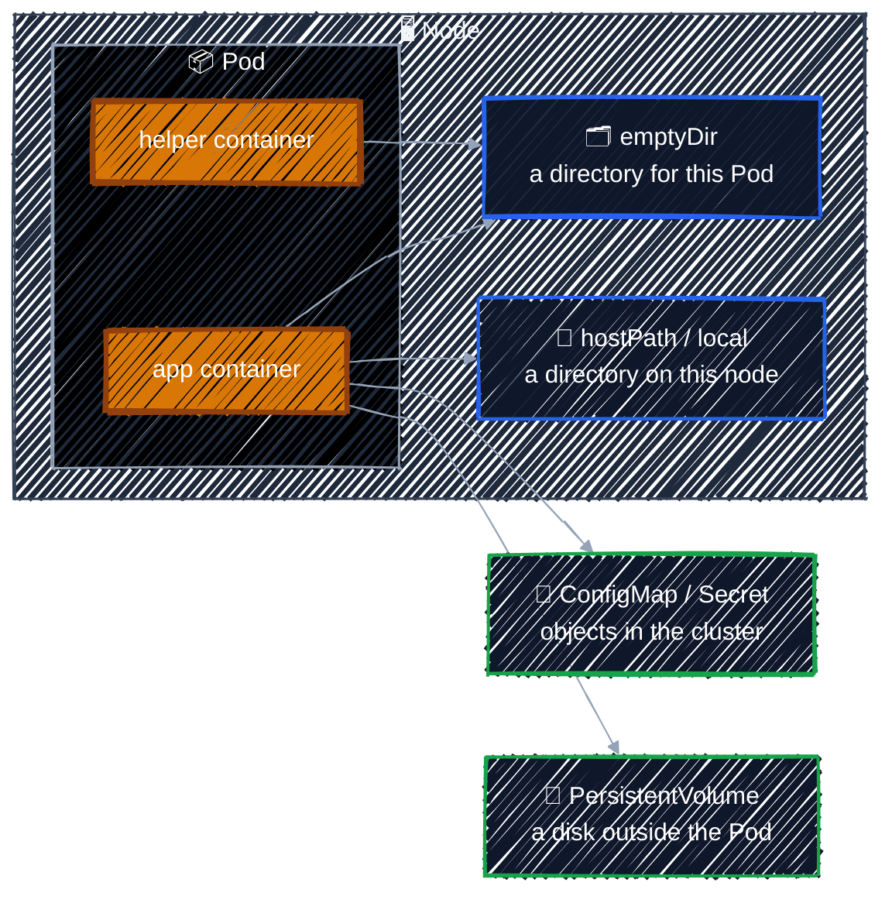

# Introduction to Volumes

> Why a container's files vanish, and the kinds of volumes that keep them: `emptyDir`, `hostPath` and `local`, and persistent storage.

---

Every container gets its own filesystem, built from its image. Whatever the app writes there lives in the container's writable layer, and that layer goes when the container does. You saw containers restarted over and over in [Liveness Probes](../resources-probes/liveness-probes.md); each restart starts the container from its image again, so anything the last one wrote is gone. And two containers in one Pod can't see each other's files at all, even though [they share everything else](../pods/what-is-a-pod.md).

A **volume** fixes both. It's a directory that lives outside any one container, and that the Pod's containers can mount. How long it lasts, and where its data really is, depends on its **type**. This chapter explains how a Pod uses a volume, which types there are, and how to choose. The next chapter, [Working with emptyDir](emptydir.md), tries the simplest one hands-on.

## Before you start

You only need a running cluster. This chapter only looks; it doesn't create anything.

## 1. Two halves: `volumes` and `volumeMounts`

A volume is declared in two places in the Pod's spec:

- **`spec.volumes`** says **what** the volume is: its name, and its type with that type's settings. It's declared once, for the whole Pod.
- **`spec.containers[*].volumeMounts`** says **where** each container sees it: the volume's name, and a `mountPath` inside that container.

```yaml
spec:
  volumes:                        # what: once, for the Pod
    - name: scratch
      emptyDir: {}                # type: an empty directory, for this Pod only
    - name: config
      configMap:                  # type: the keys of a ConfigMap, as files
        name: app-config
  containers:
    - name: app
      volumeMounts:               # where: per container
        - name: scratch
          mountPath: /tmp/work
        - name: config
          mountPath: /etc/app
          readOnly: true
    - name: helper
      volumeMounts:
        - name: scratch
          mountPath: /data        # the same volume, at another path
```

The name ties the two halves together. Each container decides for itself whether to mount a volume, and where: here `app` and `helper` share `scratch`, at different paths, and a file `app` writes to `/tmp/work/out.txt` is the file `helper` reads at `/data/out.txt`. Only `app` mounts `config`, and read-only.

Whatever the type, the container just sees a directory. The app doesn't know, or care, whether the files are on the node's disk, in a ConfigMap, or on a network disk. That's the type's business, and it's what decides the volume's lifetime:



## 2. The types you'll meet

Kubernetes has many volume types. These are the ones that matter for apps:

| Type | Data lives | Use it for |
|---|---|---|
| `emptyDir` | A directory on the node, made for the Pod (or in memory) | Scratch space, caches, and files shared between a Pod's containers |
| `hostPath` | Any directory on the node you name | Node-level agents that need the node's files. Not for apps: see below |
| `local` | A disk or directory on one specific node, as a PersistentVolume | Fast durable storage pinned to a node. Preferred over `hostPath` |
| PersistentVolume, through a PersistentVolumeClaim | Wherever the volume is: a cloud disk, NFS, a node's disk | App data that must outlive Pods: databases, uploads |
| `configMap`, `secret` | A ConfigMap or Secret object in the cluster | Configuration and credentials, as files. See [Environment Variables & Mounts](../config-and-data/env-and-mounts.md#2-as-files-on-disk) |
That's not the whole list. Cloud disks, network filesystems, and storage systems like Ceph all plug in as PersistentVolumes, through **CSI** (Container Storage Interface) drivers. Anyone can write a driver for their own storage, as long as it follows the CSI specification. Older Kubernetes had some of these built in, like `awsElasticBlockStore`; those have moved out into CSI drivers. Your app's manifest doesn't change either way: it asks for storage with a claim, and the driver provides it. The rest of this part covers claims, from [Introduction to Persistent Volume Claims](introduction-to-pvcs.md) on.

## 3. `emptyDir` and node-local volumes

### `emptyDir`: scratch space for one Pod

An `emptyDir` is created, empty, when the Pod starts on a node, and deleted with the Pod. A container that restarts finds it still there, with its files, which solves the first problem from the top of this chapter. But a Pod that's replaced, as a Deployment does in every rollout, gets a new, empty one.

By default, it's a directory on the node's disk, and counts toward the Pod's `ephemeral-storage`, as in [Introduction to Resources](../resources-probes/introduction-to-resources.md#1-the-units). With `medium: Memory`, it's a `tmpfs` in RAM instead: faster, but what's written there counts against the container's memory limit. Either way, `sizeLimit` caps its size.

### `hostPath` and `local`: a directory on the node

Both put the data on the node's own disk, so it outlives the Pod. They differ in how safely they do it.

A **`hostPath`** volume mounts any path from the node straight into the container. Two things make it a poor fit for apps:

- **Security.** The path can be anything: `/etc`, the container runtime's socket, the kubelet's files. A container with write access to the wrong path can take over the node. That's why many clusters forbid `hostPath` for ordinary workloads, as Kubernetes' baseline Pod Security Standard does.
- **The Pod doesn't know where its data is.** If the Pod is deleted and its replacement lands on another node, it mounts the same path there, and finds an empty directory, or someone else's files. Nothing in the Pod says which node it needs.

A **`local`** volume is a PersistentVolume that points at a disk or directory on one node, and **must** name that node with `nodeAffinity`. The scheduler reads it, and puts every Pod that uses the volume back on that node. Its path is set by whoever creates the PersistentVolume, not by the Pod. That's why it's preferred over `hostPath` for durable node-local storage. Its limit is the node itself: if the node goes, so does the data.

This cluster has a single node, so every Pod lands on the same one, and these differences don't show yet. On a cluster with several nodes, they decide whether a Pod finds its data.

| What happens | Container filesystem | `emptyDir` | `hostPath` | `local` PV | Network PV |
|---|---|---|---|---|---|
| Container restarts | Lost | Kept | Kept | Kept | Kept |
| Pod recreated | Lost | Lost | Kept, if same node | Kept | Kept |
| Node fails | Lost | Lost | Lost | Lost | Kept |

Two of those need a word. A `local` PersistentVolume is kept across a recreated Pod because its `nodeAffinity` puts the new Pod back on that node. And a network PersistentVolume survives a failed node because its disk can be attached to another node, and the Pod rescheduled there.

## 4. Volumes you already have

The control plane uses `hostPath` itself. The API server, a [static Pod](../getting-started/control-plane.md#static-pods), reads its certificates from the node's disk:

```bash
kubectl get pod -n kube-system -l component=kube-apiserver \
  -o jsonpath='{range .items[0].spec.volumes[*]}{.name}{"  "}{.hostPath.path}{"\n"}{end}'
```

```text
ca-certs  /etc/ssl/certs
etc-ca-certificates  /etc/ca-certificates
k8s-certs  /etc/kubernetes/pki
usr-local-share-ca-certificates  /usr/local/share/ca-certificates
usr-share-ca-certificates  /usr/share/ca-certificates
```

That's `hostPath` used as intended: a node-level component that must run on that node, and needs that node's files. An app is the opposite case.

Your own Pods have a volume too, one you never declared. Run `kubectl describe pod` on any of them, and its `Volumes:` section lists one named `kube-api-access-…`: a `projected` volume, which gathers several sources into one directory. Kubernetes adds it to every Pod, with the token and certificate the Pod would use to call the API server.

## Best practices

- **Choose a type by how long the data must live.** Scratch data: `emptyDir`. Data that must outlive the Pod: a PersistentVolumeClaim. Configuration: `configMap` or `secret`.
- **Don't keep data in the container's own filesystem.** It's gone at the next restart. Anything worth keeping goes in a volume.
- **Avoid `hostPath` in apps.** Use a PersistentVolumeClaim, or a `local` PersistentVolume if you need the node's disk.
- **Set `sizeLimit` on an `emptyDir`**, so one Pod can't fill the node's disk, or its own memory with `medium: Memory`.
- **Mount read-only when the container only reads.** `readOnly: true` on the `volumeMount` turns a bug that writes there into an error, not lost data.

---

[← Readiness Probes](../resources-probes/readiness-probes.md) · [↑ Contents](../../README.md) · [Working with emptyDir →](emptydir.md)
